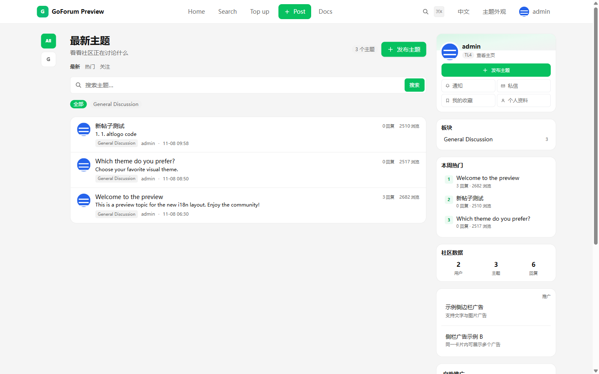
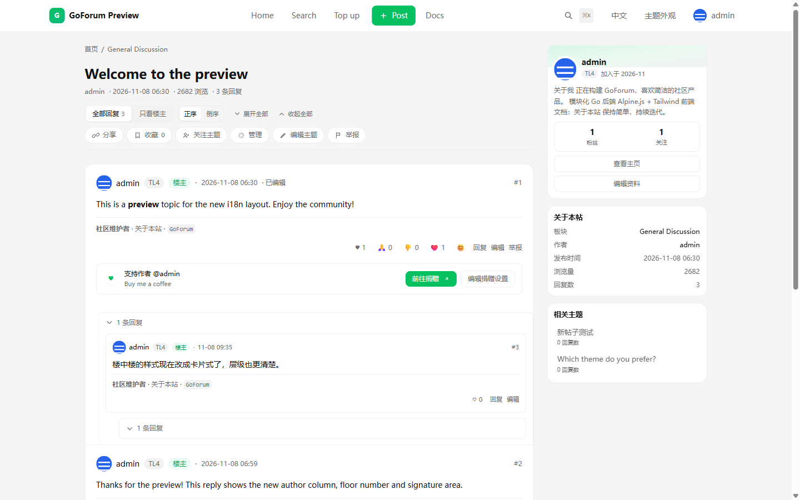
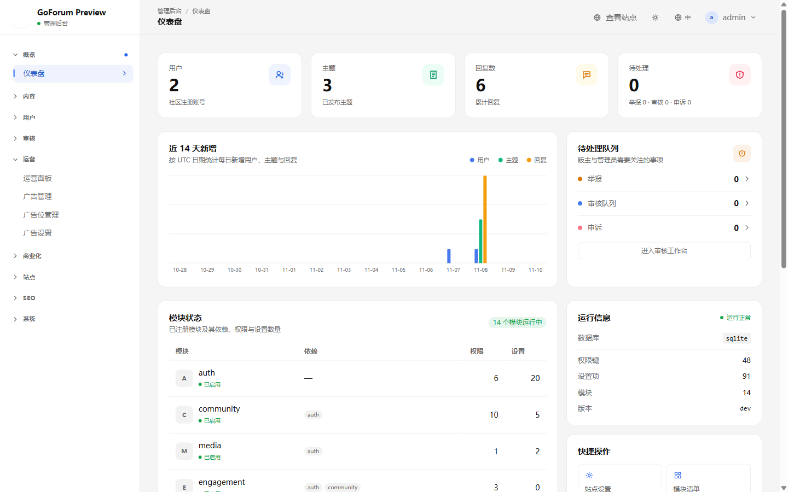
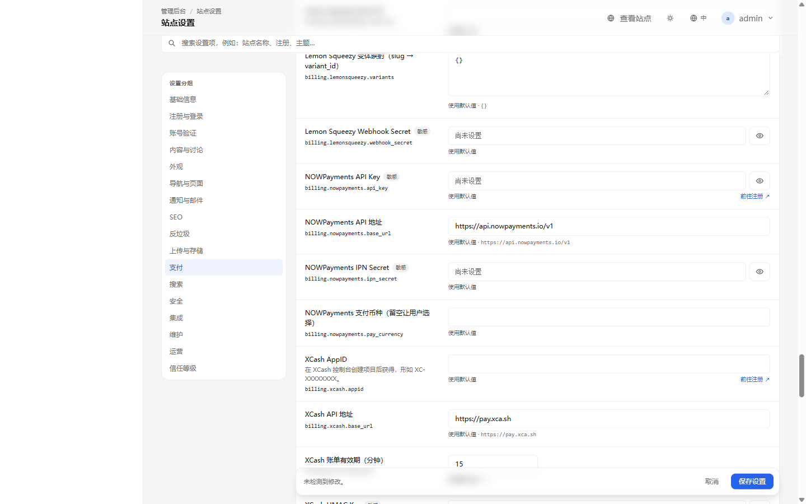

# GoForum

用 **Go + Gin + Go html/template + Alpine.js 3 + Tailwind CSS + Pines** 构建的模块化社区论坛。

- 单二进制部署，支持 **SQLite / MySQL / PostgreSQL** 自选数据库
- Discourse 式内容组织与治理 + NodeSeek 式积分、等级、邀请、抽奖等运营玩法
- 模块化单体，支付渠道可插拔，站点外观与设置由后台驱动
- 完整 SEO：服务端渲染、结构化数据、sitemap、RSS、Core Web Vitals

## 界面预览

<p align="center">
  
</p>
<p align="center"><em>首页：主题列表、板块筛选、本周热门、社区数据与侧边栏卡片。</em></p>

<p align="center">
  
</p>
<p align="center"><em>主题页：正文、回复、操作区与右侧信息栏。</em></p>

<p align="center">
  
</p>
<p align="center"><em>后台仪表盘：用户、主题、回复、待处理事项、模块状态与运行信息。</em></p>

<p align="center">
  
</p>
<p align="center"><em>支付设置：XCash / NOWPayments API 字段与注册入口。</em></p>

更多截图见 [中文产品文档](./docs/product/zh-CN/README.md) 与 [English Product Docs](./docs/product/en-US/README.md)。

## 当前状态

**菜单、主题与内容管理已落地**：导航/侧边栏改为数据库管理并提供小白化后台，新增微信/抖音/简约白主题、用户签名、NodeSeek 风格帖子页、投票与捐赠、轻量 Markdown 编辑器（内容/预览/对照）与后台主题/回复编辑；此前完成多语言与支付/邮件集成。新增 zh-CN / en-US 多语言框架、按功能拆分的翻译文件、语言切换与 hreflang；支付接入 NOWPayments、XCash、Deipay、Creem、Lemon Squeezy，邮件支持 SMTP 与 Resend。后台新增「账号验证」分组，可启停注册邮箱验证、密码找回、修改密码验证码与换绑邮箱。生产安装现在会在空库上自动建表；升级前执行 `goforum migrate`，schema 不完整时启动会直接拒绝。管理员支持 TOTP 两步验证，默认要求超管绑定，并支持 10 张一次性恢复码。敏感设置使用 AES-256-GCM 加密落库，数据库迁移改为 `schema_migrations` 版本台账。M0–M7 能力保持可用。

### 快速开始

```bash
# 1. 构建前端资源
npm install
npm run build

# 2. 启动（首次访问 /install 完成安装）
go run ./cmd/goforum
# 打开 http://127.0.0.1:8080/install
```

生产升级：

```bash
# 先配置 GF_BACKUP_KEY 并备份，再应用 schema，最后启动新版本
./bin/goforum backup
./bin/goforum migrate
./bin/goforum
```

Windows 上若端口被占用或防火墙拦截，可绑定回环地址：

```bash
HTTP_ADDR=127.0.0.1:18080 go run ./cmd/goforum
```

默认使用 SQLite（`data/goforum.db`），安装时写入 `configs/goforum.yaml`；安装完成后 `/install` 自动锁定。

### 生产一键部署

```bash
# 裸机 systemd：构建、生成密钥、安装服务
sudo ./scripts/deploy.sh --url https://forum.example.com

# Docker Compose：生成 goforum.env、构建镜像、健康检查
./scripts/docker-deploy.sh --url https://forum.example.com
```

脚本不会自动创建管理员：启动后访问 `/install` 完成安装。完整参数、升级、备份与排错见 [34 一键部署脚本与 Docker](./docs/34-一键部署脚本与Docker.md)。

## 产品文档

| 语言 | 产品文档 | AI 快速开发 |
|---|---|---|
| 中文 | [产品文档](./docs/product/zh-CN/README.md) | [AI 快速开发](./docs/product/zh-CN/AI-DEVELOPMENT.md) |
| English | [Product Documentation](./docs/product/en-US/README.md) | [AI Development Guide](./docs/product/en-US/AI-DEVELOPMENT.md) |

面向 AI 编码代理的入口：[AGENTS.md](./AGENTS.md)。

### 推荐基础设施

以下为推广链接；通过链接购买不会增加你的费用，并支持本项目持续维护。

<p>
  <a href="https://cloud.vast.ai/?ref_id=91181" target="_blank" rel="sponsored noopener">
    
  </a>
  <a href="https://my.racknerd.com/aff.php?aff=7572" target="_blank" rel="sponsored noopener">
    
  </a>
</p>

- [Vast.ai](https://cloud.vast.ai/?ref_id=91181)：按需 GPU 云，适合 AI 辅助开发、模型实验与批处理任务。
- [RackNerd](https://my.racknerd.com/aff.php?aff=7572)：预算型 VPS，适合部署 GoForum 单实例、反向代理与备份节点。

## 文档

从 [docs/README.md](./docs/README.md) 开始，包含：

| 文档 | 内容 |
|---|---|
| [01 产品需求与竞品矩阵](./docs/01-产品需求与竞品矩阵.md) | 定位、角色、Discourse/NodeSeek 对照、优先级 |
| [02 模块化架构设计](./docs/02-模块化架构设计.md) | 模块契约、依赖规则、事件、目录结构 |
| [03 功能模块规格](./docs/03-功能模块规格.md) | 10 个模块的统一规格 |
| [04 数据库设计](./docs/04-数据库设计.md) | ER 图、数据字典、三方言映射、迁移 |
| [05 API 设计](./docs/05-API设计.md) | 约定、鉴权、分页、路由、SSE |
| [06 前端架构与设计系统](./docs/06-前端架构与设计系统.md) | 资源管线、Alpine/Pines、设计 token |
| [07 页面与交互规格](./docs/07-页面与交互规格.md) | 约 30 个页面逐页十要素 |
| [08 后台管理面板设计](./docs/08-后台管理面板设计.md) | 8 组后台页面与统一范式 |
| [09 站点设置与通用站点设计](./docs/09-站点设置与通用站点设计.md) | 设置框架、品牌/主题/导航、安装向导 |
| [10 SEO 设计](./docs/10-SEO设计.md) | 索引矩阵、结构化数据、sitemap、CWV |
| [11 安全与权限设计](./docs/11-安全与权限设计.md) | RBAC + 信任等级、认证、防护、审计 |
| [12 支付网关与虚拟经济设计](./docs/12-支付网关与虚拟经济设计.md) | 渠道抽象、订单状态机、账本、对账 |
| [13 部署与运维](./docs/13-部署与运维.md) | 三库部署、Docker、备份、监控、升级 |
| [14 开发路线图与测试策略](./docs/14-开发路线图与测试策略.md) | M0–M7、测试金字塔、追溯矩阵 |
| [15 M0 实现说明](./docs/15-M0实现说明.md) | 已实现能力、与设计差异、运行方式、M1 入口 |
| [16 M1 实现说明](./docs/16-M1实现说明.md) | 注册/验证、发帖闭环、媒体、通知、后台、M2 入口 |
| [17 M2 实现说明](./docs/17-M2实现说明.md) | 互动、提及与通知偏好、私信、三方言检索、缩略图与配额 |
| [18 M3 实现说明](./docs/18-M3实现说明.md) | 举报与审核、用户组权限、信任等级、敏感词、审计、私信屏蔽、索引重建 |
| [19 M4 实现说明](./docs/19-M4实现说明.md) | 积分与流水、签到、等级、邀请、徽章、抽奖、悬赏托管 |
| [20 M5 实现说明](./docs/20-M5实现说明.md) | 商品、订单、渠道、支付幂等、退款、订阅、账本、优惠券、对账 |
| [21 M6 实现说明](./docs/21-M6实现说明.md) | 标题模板、Meta/OG、JSON-LD、robots、Sitemap、RSS、410、静态页与导航 |
| [22 M7 实现说明](./docs/22-M7实现说明.md) | 限流、请求体上限、指标、健康检查、备份、压测、升级迁移 |
| [23 支付与邮件集成](./docs/23-支付与邮件集成.md) | NOWPayments、XCash、Deipay、Creem、Lemon Squeezy、SMTP、Resend |
| [24 多语言实现](./docs/24-多语言实现.md) | i18n 框架、语言切换、按功能翻译文件、hreflang |
| [25 菜单、主题与内容管理](./docs/25-菜单主题与内容管理.md) | 导航/侧边栏 CRUD、主题预设、签名、帖子页、后台内容编辑 |
| [26 NodeSeek 对标与后续规划](./docs/26-NodeSeek对标与后续规划.md) | 竞品差距、P0/P1/P2 路线、体验优化清单 |
| [27 内容体验增强](./docs/27-内容体验增强.md) | 多表态、嵌套回复、悬浮卡、灯箱、SSE、PWA、编辑器对照 |
| [28 并发与容量设计](./docs/28-并发与容量设计.md) | 连接池、SSE、单机容量、瓶颈与高并发改造路线 |
| [29 版主与审核实现](./docs/29-版主与审核实现.md) | 举报、审核队列、处理动作、敏感词、权限与边界 |
| [30 账号验证开关](./docs/30-账号验证开关.md) | 注册邮箱验证、密码找回、修改密码验证码、换绑邮箱 |
| [31 生产部署 P0 修复](./docs/31-生产部署P0修复.md) | 生产安装自动建表、`goforum migrate`、schema 快速失败 |
| [32 管理员 TOTP 两步验证](./docs/32-管理员TOTP两步验证.md) | 管理员 2FA 策略、绑定、恢复码、登录挑战 |
| [33 密钥加密与版本化迁移](./docs/33-密钥加密与版本化迁移.md) | 设置密钥 AES-GCM 加密、schema_migrations 台账 |
| [34 一键部署脚本与 Docker](./docs/34-一键部署脚本与Docker.md) | systemd 一键脚本、Dockerfile/Compose、密钥、升级与排错 |

## 技术栈

Go 1.27+ · Gin · GORM · Go html/template · Alpine.js 3 · Tailwind CSS · Pines · SQLite/MySQL/PostgreSQL

## 参考

- [Pines 官方示例](./docs/pines/elements/)（已包含在仓库中）
- [Discourse](https://www.discourse.org/) · [NodeSeek](https://www.nodeseek.com/)

## 许可

待定。
