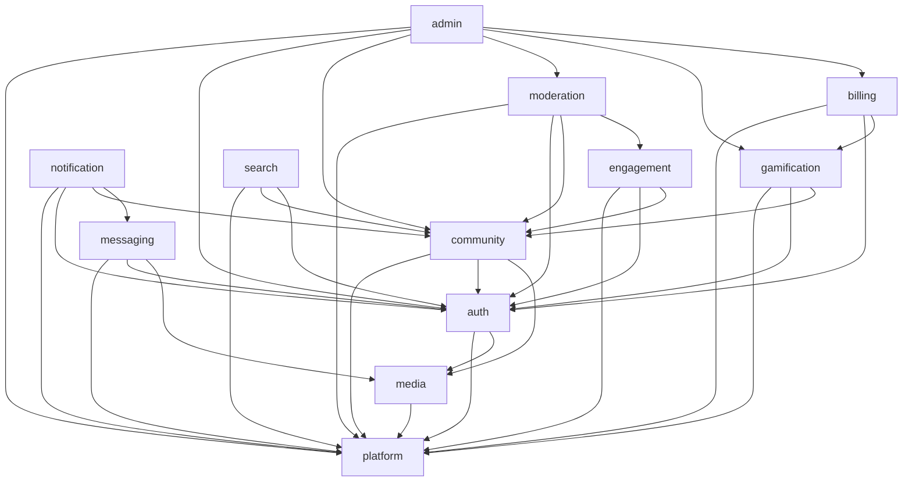

# 02 模块化架构设计

## 1. 设计目标

1. **单二进制交付**：一个可执行文件包含路由、模板、静态资源与迁移，SQLite 模式下零外部依赖。
2. **按功能垂直切分**：每个模块拥有自己的表、服务、路由、权限、设置、后台页面与测试。
3. **边界可验证**：模块依赖规则由 CI 检查，而不是靠约定。
4. **可演进**：新增功能 = 新增模块；新增支付渠道 = 新增渠道实现；新增站点外观 = 新增设置项。
5. **可拆分**：未来若需独立部署某模块（如搜索、支付），可沿现有契约与事件边界拆出。

## 2. 为什么是模块化单体

| 方案 | 结论 | 原因 |
|---|---|---|
| 微服务 | 不采用 | 论坛读多写多、事务边界清晰，微服务带来的运维与一致性成本远大于收益 |
| Go 多 module 工作区 | 不采用 | 单二进制构建复杂、版本管理繁琐；用包边界即可达到同等约束 |
| 单体 + 按层分包（handler/service/repo 全局目录） | 不采用 | 功能改动横跨多目录，边界模糊 |
| **模块化单体（垂直切片）** | **采用** | 每个模块内聚，跨模块只走契约与事件，CI 可验证 |

## 3. 目录结构

```
goforum/
├── cmd/
│   └── goforum/
│       └── main.go                 # 解析配置 → 初始化平台 → 注册模块 → 启动
├── internal/
│   ├── platform/                   # 共享内核，禁止包含业务规则
│   │   ├── config/                 # 配置加载、优先级、校验
│   │   ├── db/                     # GORM 打开、连接池、事务、ULID、软删除
│   │   │   └── dialect/            # sqlite / mysql / postgres 方言实现
│   │   ├── cache/                  # 接口 + memory / redis
│   │   ├── storage/                # 接口 + local / s3
│   │   ├── events/                 # 事件总线、outbox、订阅注册
│   │   ├── authn/                  # 当前用户上下文、会话接口
│   │   ├── permission/             # 权限键、策略判断
│   │   ├── httpx/                  # 响应信封、错误、分页、绑定、校验
│   │   ├── i18n/                   # 文案与时间/数字格式化
│   │   ├── mail/                   # 接口 + smtp / log
│   │   ├── queue/                  # 接口 + in-process / redis
│   │   ├── searchx/                # 检索接口与查询 DSL
│   │   ├── log/                    # slog、request_id、慢查询
│   │   ├── featureflag/            # 功能开关
│   │   └── clock/                  # 可注入时钟，便于测试
│   ├── modules/
│   │   ├── auth/
│   │   │   ├── module.go           # manifest：迁移、路由、权限、设置、后台、订阅
│   │   │   ├── contracts.go        # 对外接口与 DTO（唯一允许被其他模块引用）
│   │   │   ├── handler_web.go
│   │   │   ├── handler_api.go
│   │   │   ├── handler_admin.go
│   │   │   ├── service.go
│   │   │   ├── repository.go
│   │   │   ├── model.go
│   │   │   ├── events.go
│   │   │   ├── permissions.go
│   │   │   ├── settings.go
│   │   │   ├── admin.go            # 后台菜单/页面/卡片贡献
│   │   │   └── migrations/
│   │   ├── community/
│   │   ├── engagement/
│   │   ├── messaging/
│   │   ├── notification/
│   │   ├── moderation/
│   │   ├── gamification/
│   │   ├── billing/
│   │   │   ├── channels/           # balance / manual / alipay / wechat / stripe
│   │   │   └── gateway.go
│   │   ├── media/
│   │   ├── search/
│   │   └── admin/                  # 后台外壳与聚合，不含业务规则
│   └── app/
│       ├── registry.go             # 模块注册、依赖排序
│       └── bootstrap.go            # 平台初始化与中间件装配
├── web/
│   ├── templates/
│   │   ├── layouts/                # base / shell / auth / admin / blank
│   │   ├── components/             # 跨模块通用组件（Pines 本地化）
│   │   ├── pages/                  # 静态错误页、安装向导
│   │   └── modules/<module>/       # 模块自有模板
│   ├── js/
│   │   ├── app.js                  # Alpine 启动与全局 store
│   │   └── modules/<module>/       # 模块自有 Alpine.data
│   └── css/
│       └── app.css                 # Tailwind 入口与组件层
├── migrations/                     # 汇总入口（按模块顺序执行）
├── configs/
│   └── goforum.example.yaml
├── docs/
├── Makefile
└── go.mod
```

## 4. 模块契约

### 4.1 Module 接口

```go
package app

type Module interface {
    Name() string
    DependsOn() []string
    Migrations() []migration.File
    Routes(web, api *gin.RouterGroup)
    Admin() admin.Contribution
    Permissions() []permission.Definition
    Settings() []settings.Definition
    Subscribe(bus events.Bus) error
}
```

注册与装配：

```go
func Run(cfg config.Config) error {
    p := platform.New(cfg)                 // db/cache/storage/events/mail/queue/search
    mods := []app.Module{
        auth.New(p), media.New(p), community.New(p), engagement.New(p),
        messaging.New(p), notification.New(p), moderation.New(p),
        gamification.New(p), billing.New(p), search.New(p), admin.New(p),
    }
    return app.Boot(p, mods)               // 拓扑排序 → 迁移 → 路由 → 订阅
}
```

### 4.2 对外契约

每个模块只暴露 `contracts.go`：

```go
// community/contracts.go
type TopicReader interface {
    GetTopic(ctx context.Context, id ulid.ULID) (*TopicView, error)
    ListTopics(ctx context.Context, q TopicQuery) (Page[TopicView], error)
}

type TopicView struct {
    ID         ulid.ULID
    Title      string
    Slug       string
    CategoryID ulid.ULID
    AuthorID   ulid.ULID
    Status     string
    CreatedAt  time.Time
}

type ContentWriter interface {
    CreateSystemPost(ctx context.Context, topicID ulid.ULID, body string) (*PostView, error)
}
```

规则：

- 契约只包含接口与只读 DTO，不暴露 GORM 模型、repository、内部枚举实现。
- 跨模块查询一律返回 DTO，调用方不得依赖对方表结构。
- 需要写其他模块数据时，通过对方的写接口或事件，不允许直接操作对方表。

### 4.3 模块 manifest 自检

启动时与 CI 均校验：

- `Name()` 唯一且在允许清单内；
- `DependsOn()` 指向已注册模块，依赖图无环；
- `Migrations()` 文件命名合法且按版本递增；
- `Permissions()` 键全局唯一、格式为 `domain.action`；
- `Settings()` 键以模块名为 namespace；
- `Admin()` 声明的菜单权限键均已注册。

任一项不满足，启动失败并输出明确错误。

## 5. 依赖规则与 CI 检查

### 5.1 允许的依赖

```
modules/<A> → platform/*
modules/<A> → modules/<B>/contracts   （仅当 B 在 A.DependsOn() 中）
modules/<A> → modules/<A>/*           （模块内部任意）
```

### 5.2 禁止的依赖

- 跨模块引用 `model`、`repository`、`service`、`handler`。
- 模块引用 `modules/admin`（admin 只向下聚合，不被业务模块依赖）。
- `platform` 引用任何 `modules`。
- 循环依赖，包括通过 `contracts` 形成的环。

### 5.3 CI 检查项

| 检查 | 实现 |
|---|---|
| 依赖图无环 | 解析 manifest 的 `DependsOn()` |
| 禁止跨模块内部包 | `go list -deps` + import 白名单 |
| manifest 完整性 | 反射/单测检查六项非空 |
| 权限键唯一 | 汇总所有模块定义后查重 |
| 设置键唯一且带 namespace | 同上 |
| 路由冲突 | 启动时 Gin 路由树冲突检测 + 单测 |
| 迁移版本唯一 | 文件名排序检查 |
| 模板文件名冲突 | 构建期扫描 |

## 6. 请求生命周期

### 6.1 Web 页面

```
请求
 → RequestID → Recover → AccessLog → SecurityHeaders
 → Session/Auth（解析 Cookie 或 Bearer）
 → CSRF（仅写请求）
 → RateLimit（按路由与身份）
 → FeatureGate（模块开关）
 → 路由匹配
 → Handler：绑定/校验 → 调 Service
 → Service：权限判断 → 业务规则 → Repository 事务 → 写 Outbox 事件
 → View：站点设置 + SEO 上下文 + 布局 + 模块模板
 → 响应（HTML / 重定向 / 错误页）
```

### 6.2 JSON API

与 Web 相同，但响应统一信封，错误走错误码；写操作要求 `X-CSRF-Token`（Cookie 会话）或 Bearer Token。

### 6.3 后台页面

在 Web 链路上额外要求 `admin.access` 权限；后台菜单由 `admin.Contribution` 聚合生成，页面渲染前校验具体权限键。

### 6.4 事务边界

- 事务由 **Service** 开启，Repository 只接受 `*gorm.DB`。
- 一个业务用例一个事务；跨模块写操作通过事件最终一致，不跨模块长事务。
- 事务内写 `event_outbox`，提交后由 Dispatcher 投递，保证“业务成功则事件必达”。

## 7. 领域事件

### 7.1 事件总线

```go
type Event struct {
    ID            ulid.ULID
    Name          string
    AggregateType string
    AggregateID   string
    Payload       []byte          // JSON，只放 ID 与必要标量
    OccurredAt    time.Time
}

type Bus interface {
    Publish(ctx context.Context, tx *gorm.DB, e Event) error  // 写入 outbox
    Subscribe(name string, handler Handler) error
}
```

### 7.2 投递语义

- **至少一次**：Dispatcher 轮询 `event_outbox`，成功后标记 `dispatched`，失败重试并指数退避。
- 消费方必须幂等：以 `event_id` 或业务唯一键去重。
- 事件顺序：同一聚合按 `occurred_at, id` 顺序投递；不保证跨聚合顺序。
- 死信：超过最大重试次数进入 `failed_jobs`，后台可见并可重放。

### 7.3 事件目录（节选）

| 事件 | 生产者 | 消费者 | 用途 |
|---|---|---|---|
| `user.registered` | auth | notification, gamification | 欢迎通知、初始化积分 |
| `user.activated` | auth | gamification | 发放新手任务奖励 |
| `topic.created` | community | search, notification, gamification | 索引、订阅通知、积分 |
| `topic.status_changed` | community | search, notification | 索引更新、关注者通知 |
| `post.created` | community | search, notification, engagement | 索引、回复通知、@提及 |
| `post.updated` | community | search | 重建索引 |
| `reaction.added` | engagement | notification, gamification | 点赞通知、积分 |
| `flag.created` | moderation | notification, admin | 审核提醒 |
| `message.created` | messaging | notification | 私信提醒、SSE |
| `order.paid` | billing | gamification, auth, notification | 发放积分/权益、开通 VIP、收据 |
| `order.refunded` | billing | gamification, auth | 回收权益、冲正流水 |
| `points.credited` | gamification | notification | 积分变动提醒 |
| `search.reindex_requested` | admin/search | search | 全量重建索引 |

## 8. 数据访问层

### 8.1 GORM 使用规范

- 模型只放在模块 `model.go`，不跨模块引用。
- 查询必须显式 `Select` 或使用 DTO 投影，禁止 `SELECT *` 进入热点路径。
- 关联加载白名单化，禁止在循环中触发 N+1；列表页使用批量查询组装。
- 软删除统一 `deleted_at`；唯一索引需包含 `deleted_at` 或使用部分索引（方言适配）。
- 计数字段（`reply_count`、`like_count`）冗余存储，由事件或同事务更新，并提供重算任务。

### 8.2 ULID 主键

```go
func (m *Topic) BeforeCreate(tx *gorm.DB) error {
    if m.ID == "" {
        m.ID = ulid.Make().String()
    }
    return nil
}
```

- 所有表主键 `char(26)`；索引与 URL 使用同一 ID。
- 需要对外隐藏规模时，可额外提供短链，但主键不变。

### 8.3 多数据库方言层

```go
type Dialect interface {
    Name() string
    Open(cfg Config) (*gorm.DB, error)
    SupportsFullText() bool
    FullTextClause(columns []string, query string) (string, []any)
    Upsert(db *gorm.DB, table string, cols, updateCols []string, value any) *gorm.DB
    ForUpdate(db *gorm.DB) *gorm.DB
    RandomOrder(db *gorm.DB) *gorm.DB
    CaseInsensitiveLike(db *gorm.DB, col, pattern string) *gorm.DB
    JSONType() string
    BoolType() string
}
```

| 能力 | SQLite | MySQL | PostgreSQL |
|---|---|---|---|
| 连接参数 | `_pragma=journal_mode(WAL)`, `busy_timeout`, `foreign_keys(1)` | `charset=utf8mb4&parseTime=True&loc=UTC` | `sslmode`, `TimeZone=UTC` |
| 全文检索 | FTS5 虚拟表 + 触发器 | FULLTEXT（ngram） | tsvector + GIN |
| Upsert | `ON CONFLICT DO UPDATE` | `ON DUPLICATE KEY UPDATE` | `ON CONFLICT DO UPDATE` |
| 行锁 | 无（串行写） | `FOR UPDATE` | `FOR UPDATE SKIP LOCKED` |
| 随机排序 | `RANDOM()` | `RAND()` | `random()` |
| 大小写不敏感 | `LIKE`（默认 ASCII） | `utf8mb4_0900_ai_ci` | `ILIKE` / `lower()` |
| JSON | `TEXT` + `json_valid` | `JSON` | `JSONB` |
| 布尔 | `INTEGER` | `TINYINT(1)` | `BOOLEAN` |

规则：**方言差异只允许出现在 `platform/db/dialect` 与 repository 的少量显式分支**；Service 与 Handler 不得出现方言判断。

### 8.4 事务与并发

- 计数更新使用原子 SQL：`UPDATE topics SET reply_count = reply_count + 1 WHERE id = ?`。
- 状态迁移使用 CAS：`UPDATE ... SET status = ? WHERE id = ? AND status = ?`，受影响行数为 0 视为冲突。
- 高竞争场景（点赞、阅读状态）使用 Upsert + 唯一键保证幂等。
- SQLite 单写者：写事务短小，避免长事务阻塞；读多写少场景开启 WAL。

## 9. 可插拔基础设施

| 接口 | 默认实现 | 可选实现 | 关键方法 |
|---|---|---|---|
| `cache.Cache` | 内存 LRU + TTL | Redis | Get/Set/Delete/Incr/Expire |
| `storage.Storage` | 本地磁盘 | S3/OSS/MinIO | Put/Get/Delete/URL/Sign |
| `queue.Queue` | 进程内 goroutine 池 | Redis/Asynq | Enqueue/Register/Retry |
| `mail.Mailer` | 日志输出 | SMTP/API | Send(template, vars) |
| `searchx.Engine` | 数据库方言实现 | Meilisearch/OpenSearch | Index/Delete/Search |
| `events.Bus` | 数据库 outbox + 进程内分发 | Redis Stream/NATS | Publish/Subscribe |

约束：

- 业务代码只依赖接口，不依赖具体实现。
- 每个可选实现必须有契约测试，默认实现与可选实现跑同一套用例。
- 启用可选实现只改配置，不改业务代码。

## 10. 配置与功能开关

- 配置优先级：默认值 < 数据库设置 < 环境变量 < 启动参数。
- 基础设施连接信息（DSN、Redis、S3、SMTP）只从环境变量/配置文件读取，不存数据库。
- 业务开关（签到、抽奖、交易区、付费内容）使用 `feature_flags`，后台可切换。
- 模块级开关：关闭模块时路由不注册、后台菜单隐藏、事件订阅跳过；数据保留。

## 11. 权限与设置的归属

- 每个模块在 manifest 中声明权限键与设置项，启动时汇总注册。
- 权限键命名：`<domain>.<action>`，例如 `topic.create`、`topic.moderate`、`admin.user.ban`、`admin.billing.refund`。
- 设置键命名：`<module>.<group>.<key>`，例如 `community.post.min_length`。
- 后台“用户组与权限”页面按模块分组展示，新增模块自动出现。

## 12. 错误处理

```go
type AppError struct {
    Code     string            // 稳定错误码，如 topic.not_found
    HTTP     int
    Message  string            // 用户可读
    Fields   map[string]string // 表单字段错误
    Cause    error             // 仅日志
    TraceID  string
}
```

- Handler 只做绑定、校验、调用与渲染，不写业务分支。
- Service 返回 `*AppError`；未知错误统一包装为 `internal.error`，不泄露堆栈。
- Web 错误渲染错误页；API 返回统一信封；表单错误回填并保留输入。

## 13. 测试与模块隔离

- 每个模块自带 `module_test.go`：manifest 完整性、迁移可执行、路由可注册。
- Service 单测使用内存 SQLite + 假时钟 + 假事件总线。
- Repository 契约测试对三方言各跑一遍（CI 使用容器）。
- 架构测试：解析 import 图，断言无禁止依赖。
- 端到端：关键路径（注册→发帖→回复→通知→举报→审核）用 httptest 驱动。

## 14. 模块依赖图



> 说明：`admin` 只读取各模块的 `AdminContribution`，不调用业务 Service；`billing → gamification` 用于积分包发放，反向禁止。

## 15. 新增模块检查清单

- [ ] 创建 `internal/modules/<name>/`，实现 `Module` 六项
- [ ] 只通过 `contracts.go` 暴露能力
- [ ] 拥有独立表与迁移目录，表名带模块语义
- [ ] 声明权限键、设置项、后台菜单/页面
- [ ] 定义生产/消费事件，消费方幂等
- [ ] 添加 manifest、迁移、路由、架构依赖测试
- [ ] 更新 03 模块规格、04 数据字典、05 路由表、08 后台页面
- [ ] 在 `app/registry.go` 注册并确认拓扑排序

## 16. 验收标准

1. 依赖图无环，CI 能拦截跨模块内部包引用。
2. 关闭任一非核心模块，应用仍可启动，相关路由与菜单消失。
3. 事件在事务提交后必达；重复投递不产生重复副作用。
4. 三种数据库下同一套 Service 测试通过；方言差异仅存在于方言层。
5. 新增一个模块只需新增目录与注册一行，不修改既有模块业务代码。
