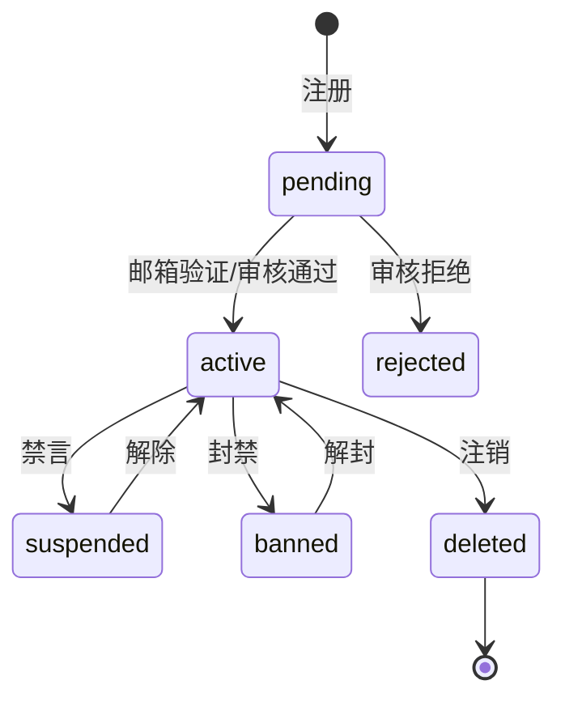
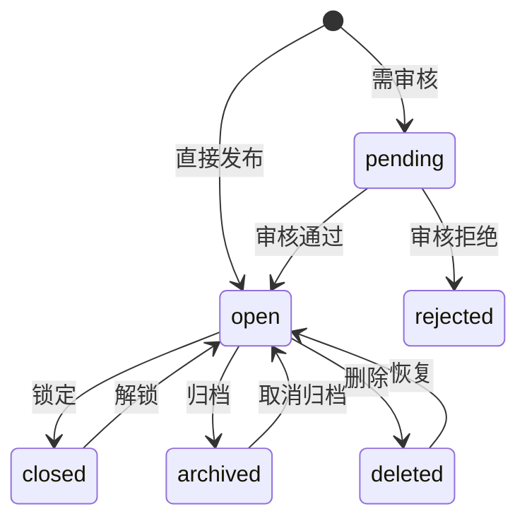

# 03 功能模块规格

> 本文按模块给出统一规格。数据表细节见 [04-数据库设计](./04-数据库设计.md)，接口见 [05-API设计](./05-API设计.md)，页面见 [07-页面与交互规格](./07-页面与交互规格.md)，后台见 [08-后台管理面板设计](./08-后台管理面板设计.md)。

统一模板：**职责与边界 → 角色与权限 → 数据归属 → 核心流程/状态机 → 对外契约 → 事件 → 页面与后台 → 配置项 → 验收标准**。

---

## 1. auth（认证与账号）

### 1.1 职责与非职责

**负责**：注册、登录、邮箱验证、找回密码、OAuth、2FA、会话与设备、用户资料、用户组、信任等级、禁言/封禁、账号注销。
**不负责**：内容权限判断（由各模块调用 `permission`）、积分与等级（gamification）、私信（messaging）。

### 1.2 角色与权限键

| 权限键 | 说明 | 默认授予 |
|---|---|---|
| `user.register` | 注册 | 游客 |
| `user.profile.edit` | 编辑自己的资料 | 登录用户 |
| `user.avatar.upload` | 上传头像 | TL1+ |
| `user.session.manage` | 管理自己的会话 | 登录用户 |
| `user.ban` | 封禁用户 | 管理员 |
| `user.suspend` | 禁言用户 | 版主/管理员 |
| `group.manage` | 管理用户组与权限 | 管理员 |
| `admin.user.view` | 查看用户列表与详情 | 管理员 |

### 1.3 数据归属

`users` `user_settings` `groups` `user_groups` `oauth_identities` `sessions` `email_tokens` `api_tokens` `two_factor` `user_blocks` `user_profile_fields`

### 1.4 状态机



- `suspended` 保留登录与浏览，禁止发帖/回复/私信，可配置只读范围。
- `banned` 禁止登录；已发内容按策略保留、隐藏或匿名化。
- 注销采用延迟删除（默认 7 天冷静期），期间可撤销。

### 1.5 核心流程

**注册**：三种模式（开放 / 邀请码 / 人工审核）。流程：校验邮箱或邀请码 → 创建 `pending` 用户 → 发送验证邮件 → 验证后置 `active` → 发 `user.registered` / `user.activated`。
**登录**：限流 → 校验密码（Argon2id）→ 2FA（如启用）→ 创建会话 → 记录设备与 IP → 轮换会话 ID。
**信任等级**：定时任务按可配置阈值计算 TL0–TL4；TL4 仅人工授予；晋升/降级发事件并通知。
**封禁/禁言**：管理员填写原因与期限 → 写 `moderation_actions` 与 `audit_logs` → 立即失效会话（封禁）→ 通知用户。

### 1.6 对外契约

`UserReader.GetUser/GetUsers/ListGroupMembers`、`SessionManager.RevokeAll`、`PermissionResolver.Resolve(userID)`、`TrustLevelReader.LevelOf`。

### 1.7 事件

生产：`user.registered`、`user.activated`、`user.profile_updated`、`user.suspended`、`user.banned`、`user.deleted`、`user.trust_level_changed`。
消费：`order.paid`（开通 VIP 用户组）、`order.refunded`（回收）。

### 1.8 页面与后台

页面：登录、注册、邀请注册、找回密码、邮箱验证、2FA、用户主页、账号设置（资料/安全/通知/偏好/Token）。
后台：用户列表、用户详情、用户组与权限、封禁禁言、登录设备、邀请记录。

### 1.9 配置项

注册模式、是否验证邮箱、密码最小长度与强度、登录失败锁定阈值、会话有效期、是否允许 OAuth、是否强制 2FA、信任等级阈值、用户名规则、头像大小限制。

### 1.10 验收标准

- 三种注册模式均可完整走通，重复邮箱/用户名被拒。
- 封禁后所有会话立即失效；禁言仅限制写操作。
- 信任等级变更可追溯，阈值修改后下次计算生效。
- 用户组权限变更后，在线用户在新请求即生效（权限缓存按版本失效）。

---

## 2. community（板块、标签、主题、回复）

### 2.1 职责与非职责

**负责**：板块树、标签与标签组、主题、回复、编辑历史、草稿、阅读状态、投票、置顶/精华/锁定/归档、慢速模式、相似主题。
**不负责**：点赞收藏（engagement）、审核判定（moderation）、积分（gamification）。

### 2.2 角色与权限键

`topic.create` `topic.reply` `topic.edit_own` `topic.edit_any` `topic.delete_own` `topic.delete_any` `topic.moderate` `topic.pin` `topic.feature` `topic.lock` `topic.move` `topic.merge` `topic.split` `category.manage` `tag.manage` `poll.create` `post.hide` `post.restore`

板块可覆盖默认权限：私有板块、只读板块、发帖需审核、最低信任等级。

### 2.3 数据归属

`categories` `category_permissions` `tags` `tag_groups` `tag_synonyms` `topics` `posts` `post_revisions` `topic_tags` `topic_users` `drafts` `polls` `poll_options` `poll_votes`

### 2.4 状态机

**主题**：



置顶、精华、已解决为独立标志位，不进入状态机。

**回复**：`visible → hidden → deleted`，均支持恢复；编辑产生 `post_revisions`。

### 2.5 核心流程

**发帖**：校验板块权限与标签规则 → 校验标题/正文长度与敏感词 → 创建主题与首楼 → 写标签、`topic_users` → 事务内写 `topic.created` 事件 → 异步索引与通知。
**回复**：校验主题状态与慢速模式 → 分配楼层号（`post_number`，主题内唯一）→ 更新计数与 `last_posted_at` → 写事件。
**阅读状态**：进入主题上报 `last_read_post_number`，服务端 Upsert `topic_users`；未读数 = 总楼层 − 已读；关注级别影响通知。
**编辑**：保留原文到修订表；超过编辑时限需权限；编辑后标记 `edited_at` 并可选通知。
**移动/合并/拆分**：版主操作，写 `moderation_actions`，更新双方计数与阅读状态。
**相似主题**：标题分词 + 标签 + 向量相似度（数据库全文或外部搜索），详情页展示 3–5 条。

### 2.6 对外契约

`TopicReader`、`CategoryReader`、`ContentWriter.CreateSystemPost`（审核/系统通知落楼）、`ReadStateWriter`。

### 2.7 事件

生产：`topic.created` `topic.updated` `topic.status_changed` `topic.moved` `topic.deleted` `post.created` `post.updated` `post.deleted` `poll.closed`。
消费：`flag.resolved`（隐藏/恢复内容）、`user.deleted`（内容匿名化）。

### 2.8 页面与后台

页面：首页信息流、板块页、标签页、主题详情、发帖、编辑、投票组件、相似主题。
后台：主题列表、回复列表、板块管理、标签管理、批量移动/合并/删除。

### 2.9 配置项

每页主题数、回复数、标题长度、正文长度、编辑时限、慢速模式默认值、是否允许匿名、是否强制标签、相似主题开关、归档天数、草稿保留天数。

### 2.10 验收标准

- 楼层号在同一主题内连续且唯一，并发回复不重号。
- 私有板块不出现在列表、搜索、sitemap 与 RSS。
- 阅读状态在跨设备时取最大值，不回退。
- 合并/拆分后计数、阅读状态、通知链接均正确。
- 删除主题后详情返回 410，列表与 sitemap 移除。

---

## 3. engagement（互动）

### 3.1 职责

点赞/表情、收藏/书签/提醒、关注（主题/板块/标签/用户）、分享计数。
**不负责**：通知投递（notification 消费事件）、积分（gamification 消费事件）。

### 3.2 权限键

`reaction.create` `bookmark.create` `subscription.create` `share.create`；均要求登录，受信任等级与频率限制。

### 3.3 数据归属

`reactions` `bookmarks` `subscriptions` `share_links`

### 3.4 核心流程

- 点赞：唯一键 `(user_id, target_type, target_id, reaction)`；重复请求幂等；计数原子增减。
- 收藏：支持备注与提醒时间；到期由任务发通知。
- 关注：`subscription_level` 为 `watching/tracking/normal/muted`；主题关注影响通知，板块/标签关注影响信息流。
- 分享：生成短链，记录来源与点击；短链解析到规范 URL。

### 3.5 事件

生产：`reaction.added` `reaction.removed` `bookmark.created` `subscription.changed`。
消费：`topic.deleted` `post.deleted`（清理关联）、`user.deleted`。

### 3.6 验收标准

- 并发重复点赞只产生一条记录与一次计数。
- 取消点赞后计数不为负。
- 静音（muted）后不再产生任何通知。
- 短链失效或目标删除时返回 410。

---

## 4. messaging（私信）

### 4.1 职责

一对一会话、多人会话、消息、已读状态、屏蔽、举报私信。
**不负责**：内容渲染（复用 Markdown/上传能力）、通知投递（发事件）。

### 4.2 权限键

`message.send` `message.read` `message.block` `admin.message.view`（仅巡查，需审计）。

### 4.3 数据归属

`conversations` `conversation_participants` `messages`

### 4.4 核心流程

- 创建会话：校验对方未屏蔽自己、非封禁、信任等级满足；同一对用户复用未归档会话。
- 发送消息：写入 `messages` → 更新会话 `last_message_at` → 参与者未读数 +1 → 发 `message.created`。
- 已读：按参与者记录 `last_read_message_id`，未读数为区间计数。
- 屏蔽：屏蔽后对方无法发起新会话；已有会话只读。
- 举报：生成 flag，目标类型为 `message`，审核员可查看上下文（审计）。

### 4.5 事件

生产：`message.created` `conversation.created` `message.reported`。
消费：`user.banned`（会话只读）、`user.deleted`（匿名化）。

### 4.6 页面与后台

页面：私信列表、会话详情、新建私信。
后台：私信巡查（需理由与审计）、举报关联查看。

### 4.7 验收标准

- 未参与者无法读取会话（404 而非 403，避免探测）。
- 屏蔽与封禁状态下发送被拒且提示明确。
- 已读状态跨设备一致；未读数不为负。

---

## 5. notification（通知）

### 5.1 职责

站内通知、通知偏好、邮件摘要、SSE 推送、通知模板。
**不负责**：产生业务事件（各模块）、邮件传输（mail 接口）。

### 5.2 数据归属

`notifications` `notification_preferences` `notification_templates` `email_digests`（SSE 连接状态保存在进程内存，不落库）

### 5.3 通知类型矩阵

| 类型 | 触发 | 默认级别 | 渠道 |
|---|---|---|---|
| `post.reply` | 回复我的主题/我参与的帖子 | 站内 | 站内 + 摘要 |
| `post.mention` | @我 | 站内 | 站内 + 即时邮件（可关） |
| `post.quote` | 引用我的帖子 | 站内 | 站内 |
| `reaction` | 点赞我的内容 | 站内（合并） | 站内 |
| `topic.invite` | 被邀请参与 | 站内 | 站内 |
| `message.new` | 新私信 | 站内 | 站内 + 即时 |
| `moderation.action` | 内容被处理/账号被限制 | 强制 | 站内 + 邮件 |
| `badge.awarded` | 获得徽章 | 站内 | 站内 |
| `points.changed` | 积分变动 | 站内（合并） | 站内 |
| `order.paid` / `order.refunded` | 支付结果 | 强制 | 站内 + 邮件 |
| `subscription.expiring` | 订阅到期前 7/1 天 | 强制 | 站内 + 邮件 |
| `digest.daily/weekly` | 摘要 | 用户可选 | 邮件 |

合并策略：同一目标 10 分钟内的点赞合并为一条；同一主题的未读回复合并计数。

### 5.4 核心流程

事件 → 解析接收人（作者、关注者、@对象、参与者）→ 读取偏好与静音 → 去重/合并 → 写 `notifications` → SSE 推送在线用户 → 满足条件时入邮件队列。

### 5.5 对外契约

`Notifier.Notify(ctx, Notification)`、`Notifier.NotifyMany`、`PreferenceReader`。

### 5.6 事件

消费：几乎所有业务事件。
生产：`notification.created`、`digest.sent`。

### 5.7 页面与后台

页面：通知中心（全部/未读/@我/系统）、通知偏好。
后台：通知模板、邮件模板、投递日志、摘要任务、SSE 连接数。

### 5.8 验收标准

- 静音后零通知；关闭邮件后只留站内。
- 同一事件重复投递不产生重复通知（事件 ID 去重）。
- SSE 断线自动重连并补拉未读数；不支持 SSE 时降级轮询。
- 邮件摘要按用户时区在设定时间发送。

---

## 6. moderation（治理）

### 6.1 职责

举报、审核队列、版主工具、敏感词、禁言封禁执行、审计日志、小黑屋公示、申诉（P2）。
**不负责**：内容存储（community）、用户状态存储（auth，调用其接口）。

### 6.2 权限键

`flag.create`（用户）`flag.review` `moderation.queue.view` `moderation.action` `moderation.word.manage` `moderation.audit.view` `moderation.appeal.handle`

### 6.3 数据归属

`flags` `review_queue` `moderation_actions`（含处罚记录） `banned_words` `audit_logs` `appeals`

### 6.4 状态机

**举报**：`pending → reviewing → resolved(actioned) | rejected`，支持 `duplicate`。
**审核项**：`pending → approved | rejected | escalated`。
**处罚**：`active → expired | revoked`。

### 6.5 核心流程

- 举报：校验频率与目标可见性 → 写 flag 与审核项 → 通知版主 → 达到阈值自动隐藏（可配置）。
- 审核：领取（防并发）→ 查看上下文 → 选择动作（通过/隐藏/删除/禁言/封禁/升级）→ 写 `moderation_actions` 与 `audit_logs` → 通知作者 → 关闭项。
- 敏感词：支持精确/包含/正则；命中策略为拦截、转审核、替换；按板块覆盖。
- 版主工具：移动、合并、拆分、置顶、精华、锁定、删除、恢复、批量操作。
- 小黑屋：公示处罚记录（可匿名化），支持期限与理由。
- 审计：所有管理写操作必须记录 actor、IP、request_id、before/after、理由。

### 6.6 事件

生产：`flag.created` `flag.resolved` `moderation.action_taken` `user.punished`。
消费：`post.created` `topic.created`（规则引擎判定是否入审核）、`order.refunded`（争议处理，可选）。

### 6.7 页面与后台

页面：举报弹层、我的举报记录、小黑屋。
后台：审核队列、举报列表、审核详情、敏感词、处罚记录、审计日志、申诉。

### 6.8 验收标准

- 同一审核项只能被一个管理员领取；释放后可重新领取。
- 每个管理动作都有审计记录，不可删除。
- 自动隐藏阈值可配置，且不会隐藏管理员/版主内容（可配置例外）。
- 审计日志支持按 actor、目标、时间、动作筛选与导出。

---

## 7. gamification（运营玩法）

### 7.1 职责

积分规则与账本、等级、签到、邀请、徽章、抽奖、悬赏托管。
**不负责**：真实货币支付（billing）、权限判定（auth/permission）。

### 7.2 数据归属

`point_rules` `point_balances` `point_transactions` `levels` `checkins` `badges` `user_badges` `invites` `lotteries` `lottery_entries` `bounties`

### 7.3 积分规则

| 行为 | 默认积分 | 频率限制 | 备注 |
|---|---|---|---|
| 每日签到 | +5（连续 7 天 +20） | 每日 1 次 | 可配置 |
| 发布主题 | +10 | 每日上限 5 次 | 需通过审核 |
| 发布回复 | +2 | 每日上限 20 次 | 被删除则扣回 |
| 获得点赞 | +1 | 每日上限 20 | 取消点赞扣回 |
| 主题被设为精华 | +50 | — | 版主操作 |
| 被举报成立 | −20 | — | 可配置 |
| 兑换/消费 | 负数 | — | 走账本 |

规则以 `point_rules` 配置，变更需审计；所有变动写 `point_transactions`，带幂等键与 `balance_after`。

### 7.4 核心流程

- **签到**：唯一键 `(user_id, checkin_date)`；连续天数按自然日与用户时区；断签重置；发事件。
- **等级**：按累计积分或活跃度计算 Lv0–Lv6，阈值可配置；等级影响权限与展示。
- **邀请**：生成邀请码（数量配额、有效期、绑定邮箱可选）；注册消费邀请码 → 邀请人获得积分；记录 `invited_by`。
- **徽章**：手动授予或规则触发（如首个精华、连续签到 30 天）；支持隐藏徽章。
- **抽奖**：创建（奖品、名额、截止时间、参与条件）→ 参与（扣积分或免费）→ 截止开奖（随机种子可审计）→ 发放奖品 → 通知。
- **悬赏**：发布时冻结积分 → 采纳答案结算 → 到期未采纳自动退款 → 争议由管理员处理。

### 7.5 事件

生产：`points.credited` `points.debited` `checkin.completed` `badge.awarded` `invite.used` `lottery.drawn` `bounty.settled`。
消费：`post.created` `reaction.added` `topic.featured` `order.paid`（积分包）。

### 7.6 页面与后台

页面：签到、积分明细、等级、徽章墙、邀请、抽奖、悬赏。
后台：积分规则、等级配置、签到配置、徽章、邀请码、抽奖管理、悬赏处理、积分流水。

### 7.7 验收标准

- 积分余额 = 流水累计，任何时刻可重算一致。
- 同一行为重复触发不重复加分（幂等键）。
- 悬赏冻结金额不可被重复消费；结算与退款金额守恒。
- 抽奖结果可复现审计（记录种子与参与名单哈希）。

---

## 8. billing（商业化与支付）

> 完整设计见 [12-支付网关与虚拟经济设计](./12-支付网关与虚拟经济设计.md)。

### 8.1 职责

商品与定价、订单、支付渠道、支付回调、退款、订阅、权益、余额账本、优惠券、对账、发票（可选）。
**不负责**：积分规则（gamification）、用户组开通（调用 auth 契约）。

### 8.2 数据归属

`payment_channels` `products` `orders` `order_items` `payment_transactions` `payment_notify_logs` `refunds` `coupons` `coupon_redemptions` `subscriptions` `entitlements` `ledger_accounts` `ledger_transactions` `ledger_entries` `invoices` `reconciliation_runs` `reconciliation_diffs`

### 8.3 核心流程

下单 → 选择渠道 → 创建支付意图 → 用户支付 → 渠道回调（验签/金额/幂等）→ 订单置 paid → 同一事务写流水与账本 → 发放权益（积分/用户组/内容授权）→ 通知 → 对账。

### 8.4 验收标准

- 回调重放不重复发放权益。
- 金额、币种、渠道与订单不一致时拒绝并告警。
- 退款后权益按策略回收，账本冲正可追溯。
- 新增渠道不改订单、账本、后台核心代码。

---

## 9. media（媒体与附件）

### 9.1 职责

图片/附件上传、校验、压缩、缩略图、存储适配、配额、引用计数、清理孤儿文件。
**不负责**：内容归属（记录 uploader 与引用方即可）。

### 9.2 数据归属

`uploads` `upload_variants` `upload_references` `storage_quotas`

### 9.3 上传流程

```
选择/粘贴/拖拽
 → 前端校验大小与类型（快速失败）
 → POST /api/v1/uploads（multipart 或分片）
 → 服务端：配额 → MIME 嗅探（不信任扩展名）→ 病毒/恶意内容扫描（可选）
 → 图片：解码 → 纠正 EXIF 方向 → 去 EXIF → 限制尺寸 → 生成 WebP/AVIF + 缩略图
 → 计算 SHA-256（去重）
 → 写入 storage → 落库 uploads/variants
 → 返回附件 ID 与 URL（签名或公开）
```

### 9.4 安全要求

- 扩展名白名单 + MIME 嗅探双重校验；默认禁止 SVG、HTML、可执行文件。
- 图片必须重新编码，剥离元数据；限制像素总量防解压炸弹。
- 上传目录不可执行；生产使用独立域名/CDN。
- 私有附件通过签名 URL 访问，有效期可配置。
- 定期清理无引用且超期的上传。

### 9.5 验收标准

- 伪造扩展名的可执行文件被拒。
- 超大图片被拒绝或降采样，不导致内存溢出。
- 同一文件重复上传按哈希复用存储。
- 删除内容后附件按策略延迟清理，引用计数正确。

---

## 10. search（搜索）

### 10.1 职责

索引维护、关键词检索、筛选与排序、热词、搜索建议、相似主题、索引重建。
**不负责**：内容权限（查询时调用权限过滤）、内容写入（消费事件）。

### 10.2 数据归属

`search_documents`（可选，统一投影）`search_queries`（热词，可脱敏）`search_synonyms`

### 10.3 索引策略

| 数据库 | 实现 | 说明 |
|---|---|---|
| SQLite | FTS5 虚拟表 + 触发器 | 主题标题/正文、回复正文；中文使用 unigram/bigram 分词或 `unicode61` + 预处理 |
| MySQL | FULLTEXT（ngram parser） | 需 `ngram_token_size=2`；标题权重高于正文 |
| PostgreSQL | `tsvector` + GIN | 中文需 `zhparser` 或应用层分词后写入 |
| 外部 | Meilisearch/OpenSearch | 通过 `searchx.Engine` 接口启用 |

统一投影 `search_documents`：`doc_id`、`type(topic/post/user/tag)`、`title`、`body`、`category_id`、`author_id`、`tags`、`visibility`、`created_at`、`updated_at`、`score_hint`。

### 10.4 查询与排序

- 查询语法：关键词 + 可选 `category:` `tag:` `author:` `after:` 过滤。
- 排序：相关度（默认）、最新、最多回复、最多点赞。
- 权限：查询前注入可见板块集合；私有内容永不返回。
- 分页：搜索使用页码分页，最大页数限制；深分页返回 `noindex`。
- 热词：按日聚合脱敏查询词，过滤敏感词与低频词。

### 10.5 验收标准

- 新增/编辑/删除内容在 5 秒内反映到搜索结果。
- 私有板块内容对无权限用户零泄露（包括总数与高亮片段）。
- 索引重建可在线进行，期间搜索降级为数据库 `LIKE` 且不影响写入。
- 三种数据库下同一查询语义一致（除相关度细微差异）。

---

## 11. admin（后台外壳与聚合）

### 11.1 职责

后台布局、导航聚合、仪表盘卡片聚合、命令面板、通用列表/表单组件、审计入口、系统状态。
**不负责**：任何业务规则；页面数据由各模块的 `AdminContribution` 提供。

### 11.2 聚合模型

```go
type Contribution struct {
    Nav      []NavItem          // 分组、排序、权限键
    Pages    []Page             // 路由、处理器、权限键、面包屑
    Widgets  []Widget           // 仪表盘卡片
    Settings []SettingGroup     // 设置面板
}
```

- 后台启动时收集所有模块贡献，按 `order` 排序，过滤无权限项。
- 新增模块只实现 `Admin()`，后台导航、权限树、仪表盘自动出现。
- 页面渲染统一走 `admin` 布局与表格/表单组件，保证交互一致。

### 11.3 验收标准

- 无权限的菜单项不出现；直接访问返回 403 并记录审计。
- 模块被关闭后其后台页面与菜单同时消失。
- 仪表盘卡片失败不影响其他卡片（独立超时与错误边界）。
