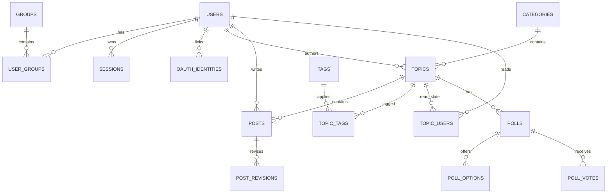
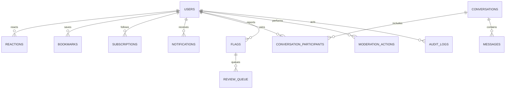
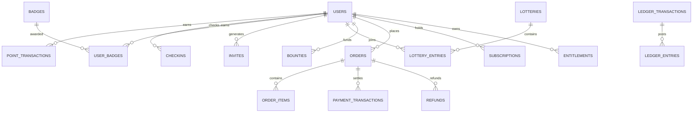
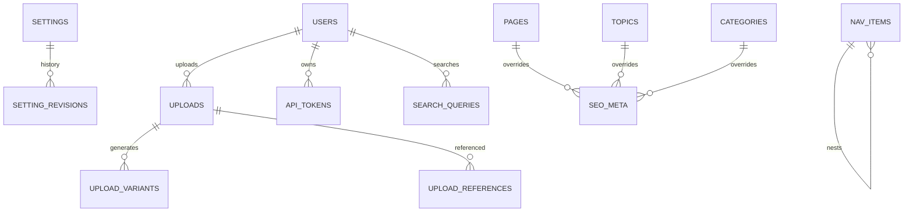

# 04 数据库设计

> 一套模型支持 SQLite / MySQL / PostgreSQL。字段类型以“逻辑类型”描述，物理类型由方言层映射。

## 1. 设计原则

1. **主键统一 ULID**（`char(26)`）：跨库一致、按时间有序、URL 稳定、无自增冲突。
2. **时间统一 UTC**，字段 `created_at` / `updated_at`；软删除 `deleted_at`（可空）。
3. **不使用数据库外键级联**：约束在应用层保证，避免跨库行为差异与误删。
4. **计数冗余但可重算**：`reply_count`、`like_count` 等由同事务或事件维护，并提供重算任务。
5. **金额用整数最小单位**：`amount_minor BIGINT` + `currency CHAR(3)`，禁止浮点。
6. **JSON 只存扩展数据**，可检索字段必须独立成列。
7. **索引服务于查询**：每个高频列表/详情查询必须有对应索引；禁止无索引的大表扫描。
8. **表按模块归属**，跨模块只通过 ID 引用，不建立跨模块强关联。

## 2. 通用字段与类型

| 逻辑类型 | SQLite | MySQL | PostgreSQL | 用法 |
|---|---|---|---|---|
| ULID | `TEXT` / `CHAR(26)` | `CHAR(26)` | `CHAR(26)` | 主键、外键引用 |
| 短文本 | `TEXT` | `VARCHAR(n)` | `VARCHAR(n)` | 用户名、标题、slug |
| 长文本 | `TEXT` | `MEDIUMTEXT` | `TEXT` | 正文、HTML |
| 布尔 | `INTEGER` | `TINYINT(1)` | `BOOLEAN` | 标志位 |
| 整数 | `INTEGER` | `BIGINT` | `BIGINT` | 计数、积分 |
| 金额 | `INTEGER` | `BIGINT` | `BIGINT` | 最小货币单位 |
| JSON | `TEXT`（`json_valid`） | `JSON` | `JSONB` | 元数据、快照 |
| 时间 | `DATETIME` | `DATETIME(3)` | `TIMESTAMPTZ` | UTC |
| 枚举 | `TEXT` + CHECK | `VARCHAR` + CHECK | `VARCHAR` + CHECK | 状态机 |
| IP | `TEXT` | `VARCHAR(45)` | `INET`/`VARCHAR(45)` | 审计、风控 |

---

## 3. ER 图

### 3.1 身份与内容



### 3.2 互动、通知与治理



### 3.3 运营与商业化



### 3.4 平台、媒体与搜索



---

## 4. 数据字典

### 4.1 auth（11 张）

| 表 | 用途 | 关键字段 | 索引 / 约束 |
|---|---|---|---|
| `users` | 用户主表 | id, username, username_lower, email, email_lower, email_verified_at, password_hash, avatar_upload_id, bio, locale, timezone, primary_group_id, trust_level, level, status, suspended_until, banned_until, last_seen_at, last_posted_at, topic_count, post_count, like_given_count, like_received_count, points_balance, invite_quota, invited_by, two_factor_enabled | `uk(username_lower)`, `uk(email_lower)`, `idx(status, created_at)`, `idx(trust_level)`, `idx(invited_by)` |
| `user_settings` | 用户偏好 | user_id, theme, locale, timezone, email_digest, notify_json, privacy_json, editor_json | `pk(user_id)` |
| `groups` | 用户组 | id, name, slug, color, priority, is_default, is_system, permissions_json, description | `uk(slug)` |
| `user_groups` | 用户-组 | user_id, group_id, expires_at, granted_by | `pk(user_id, group_id)`, `idx(group_id)` |
| `oauth_identities` | 第三方登录 | id, user_id, provider, provider_uid, union_id, data_json | `uk(provider, provider_uid)`, `idx(user_id)` |
| `sessions` | 会话 | id, user_id, token_hash, ip, user_agent, device_label, last_active_at, expires_at, revoked_at | `uk(token_hash)`, `idx(user_id, last_active_at)` |
| `email_tokens` | 验证/重置令牌 | id, user_id, purpose, token_hash, expires_at, used_at | `uk(token_hash)`, `idx(user_id, purpose)` |
| `api_tokens` | API 令牌 | id, user_id, name, token_hash, scopes, last_used_at, expires_at, revoked_at | `uk(token_hash)`, `idx(user_id)` |
| `two_factor` | 2FA 密钥 | user_id, secret_enc, recovery_codes_enc, confirmed_at | `pk(user_id)` |
| `user_blocks` | 用户屏蔽 | blocker_id, blocked_id, scope, created_at | `pk(blocker_id, blocked_id)`, `idx(blocked_id)` |
| `user_profile_fields` | 自定义资料字段值 | user_id, field_key, value | `pk(user_id, field_key)` |

### 4.2 community（14 张）

| 表 | 用途 | 关键字段 | 索引 / 约束 |
|---|---|---|---|
| `categories` | 板块 | id, parent_id, name, slug, description, color, icon, position, topic_count, post_count, visibility(public/private/unlisted), require_approval, min_trust_level, slow_mode_seconds, is_archived | `uk(slug)`, `idx(parent_id, position)` |
| `category_permissions` | 板块权限覆盖 | category_id, group_id, permissions_json | `pk(category_id, group_id)` |
| `tags` | 标签 | id, name, slug, color, description, tag_group_id, topic_count, is_featured | `uk(slug)`, `idx(tag_group_id)` |
| `tag_groups` | 标签组 | id, name, slug, position, required, min_tags, max_tags | `uk(slug)` |
| `tag_synonyms` | 标签同义词 | tag_id, synonym, locale | `uk(synonym)`, `idx(tag_id)` |
| `topics` | 主题 | id, category_id, user_id, title, slug, excerpt, archetype, status, is_pinned, is_featured, is_solved, pinned_until, closed_at, archived_at, reply_count, post_count, view_count, like_count, bookmark_count, participant_count, word_count, last_post_id, last_poster_id, last_posted_at, bumped_at, slow_mode_seconds, visibility, meta_json, deleted_at | `idx(category_id, status, is_pinned, bumped_at)`, `idx(user_id, created_at)`, `idx(status, bumped_at)`, `idx(last_posted_at)` |
| `posts` | 回复 | id, topic_id, user_id, post_number, reply_to_post_id, raw, cooked_html, cooked_version, status, action, like_count, reply_count, word_count, edit_count, edited_at, edit_reason, deleted_by, ip, user_agent, deleted_at | `uk(topic_id, post_number)`, `idx(topic_id, status, post_number)`, `idx(user_id, created_at)` |
| `post_revisions` | 编辑历史 | id, post_id, user_id, raw, reason, created_at | `idx(post_id, created_at)` |
| `topic_tags` | 主题-标签 | topic_id, tag_id | `pk(topic_id, tag_id)`, `idx(tag_id, topic_id)` |
| `topic_users` | 阅读状态 | topic_id, user_id, last_read_post_number, highest_post_number, notification_level, last_visited_at, total_msecs_viewed | `pk(topic_id, user_id)`, `idx(user_id, last_visited_at)` |
| `drafts` | 草稿 | id, user_id, draft_key, topic_id, category_id, title, raw, tags_json, updated_at | `uk(user_id, draft_key)` |
| `polls` | 投票 | id, topic_id, question, type, status, closes_at, voter_count | `idx(topic_id)` |
| `poll_options` | 选项 | id, poll_id, label, position, vote_count | `idx(poll_id, position)` |
| `poll_votes` | 投票记录 | id, poll_id, option_id, user_id, created_at | `uk(poll_id, option_id, user_id)` |

### 4.3 engagement（4 张）

| 表 | 用途 | 关键字段 | 索引 / 约束 |
|---|---|---|---|
| `reactions` | 点赞/表情 | id, user_id, target_type(topic/post/message), target_id, reaction, created_at | `uk(user_id, target_type, target_id, reaction)`, `idx(target_type, target_id)` |
| `bookmarks` | 收藏 | id, user_id, target_type, target_id, note, remind_at, created_at | `uk(user_id, target_type, target_id)`, `idx(user_id, created_at)`, `idx(remind_at)` |
| `subscriptions` | 关注 | id, user_id, target_type(topic/category/tag/user), target_id, level(watching/tracking/normal/muted), created_at | `uk(user_id, target_type, target_id)`, `idx(target_type, target_id)` |
| `share_links` | 分享短链 | id, code, target_type, target_id, user_id, clicks, expires_at | `uk(code)`, `idx(target_type, target_id)` |

### 4.4 messaging（3 张）

| 表 | 用途 | 关键字段 | 索引 / 约束 |
|---|---|---|---|
| `conversations` | 会话 | id, type(direct/group), title, created_by, last_message_at, last_message_id, participant_count, is_archived | `idx(last_message_at)` |
| `conversation_participants` | 参与者 | conversation_id, user_id, last_read_message_id, unread_count, muted, joined_at, left_at | `pk(conversation_id, user_id)`, `idx(user_id, last_read_message_id)` |
| `messages` | 私信消息 | id, conversation_id, sender_id, raw, cooked_html, status, created_at, deleted_at | `idx(conversation_id, created_at)`, `idx(sender_id)` |

### 4.5 notification（4 张）

| 表 | 用途 | 关键字段 | 索引 / 约束 |
|---|---|---|---|
| `notifications` | 站内通知 | id, user_id, type, actor_id, target_type, target_id, data_json, read_at, created_at | `idx(user_id, read_at, created_at)`, `idx(user_id, type, created_at)` |
| `notification_preferences` | 通知偏好 | user_id, type, in_app, email, digest, muted | `pk(user_id, type)` |
| `notification_templates` | 模板 | id, key, locale, subject, body_html, body_text, updated_at | `uk(key, locale)` |
| `email_digests` | 摘要记录 | id, user_id, period, sent_at, item_count, status | `uk(user_id, period)`, `idx(sent_at)` |

### 4.6 moderation（6 张）

| 表 | 用途 | 关键字段 | 索引 / 约束 |
|---|---|---|---|
| `flags` | 举报 | id, reporter_id, target_type, target_id, reason_code, reason_text, status, weight, handled_by, handled_at, resolution | `idx(status, created_at)`, `idx(target_type, target_id)` |
| `review_queue` | 审核队列 | id, item_type(post/topic/user/message), item_id, source(auto/flag/new_user), status, priority, claimed_by, claimed_at, decided_by, decided_at, decision, note | `uk(item_type, item_id)`, `idx(status, priority, created_at)` |
| `moderation_actions` | 管理动作/处罚 | id, actor_id, action, target_type, target_id, reason, duration_seconds, expires_at, revoked_at, metadata_json, created_at | `idx(target_type, target_id, created_at)`, `idx(actor_id, created_at)` |
| `banned_words` | 敏感词 | id, word, match_type(exact/contains/regex), action(block/review/replace), replacement, category_id, enabled | `uk(word, category_id)` |
| `audit_logs` | 审计日志 | id, actor_id, action, target_type, target_id, before_json, after_json, ip, request_id, reason, created_at | `idx(actor_id, created_at)`, `idx(target_type, target_id)`, `idx(created_at)` |
| `appeals` | 申诉（P2） | id, user_id, action_id, content, status, handled_by, handled_at | `idx(status, created_at)` |

### 4.7 gamification（11 张）

| 表 | 用途 | 关键字段 | 索引 / 约束 |
|---|---|---|---|
| `point_rules` | 积分规则 | id, code, name, points, daily_limit, enabled, conditions_json | `uk(code)` |
| `point_balances` | 积分余额 | user_id, balance, total_earned, total_spent, updated_at | `pk(user_id)` |
| `point_transactions` | 积分流水 | id, user_id, amount, balance_after, rule_code, ref_type, ref_id, description, created_at | `idx(user_id, created_at)`, `uk(ref_type, ref_id, rule_code, user_id)` |
| `levels` | 等级配置 | id, level, name, min_points, color, icon, permissions_json | `uk(level)` |
| `checkins` | 签到 | id, user_id, checkin_date, streak, points, created_at | `uk(user_id, checkin_date)`, `idx(checkin_date)` |
| `badges` | 徽章 | id, slug, name, description, icon, rule_json, is_hidden | `uk(slug)` |
| `user_badges` | 用户徽章 | id, user_id, badge_id, awarded_by, awarded_at, note | `uk(user_id, badge_id)`, `idx(badge_id)` |
| `invites` | 邀请码 | id, code, inviter_id, email, status, used_by, used_at, expires_at, note | `uk(code)`, `idx(inviter_id, created_at)` |
| `lotteries` | 抽奖 | id, title, description, prize, winner_count, entry_cost, min_level, starts_at, ends_at, status, seed, drawn_at | `idx(status, ends_at)` |
| `lottery_entries` | 参与记录 | id, lottery_id, user_id, ticket_no, created_at | `uk(lottery_id, user_id)`, `idx(lottery_id, ticket_no)` |
| `bounties` | 悬赏 | id, topic_id, user_id, amount, status, accepted_post_id, settled_at, refunded_at | `uk(topic_id)`, `idx(status)` |

### 4.8 billing（17 张）

| 表 | 用途 | 关键字段 | 索引 / 约束 |
|---|---|---|---|
| `payment_channels` | 渠道实例 | id, driver, name, enabled, mode(sandbox/live), sort, currencies, config_enc, limits_json | `uk(driver, name)` |
| `products` | 商品 | id, type(points/vip/invite/paid_content/badge/custom), name, slug, description, price_minor, currency, duration_days, points_amount, group_id, stock, active, sort, metadata_json | `uk(slug)`, `idx(type, active, sort)` |
| `orders` | 订单 | id, out_trade_no, user_id, product_id, product_type, product_snapshot_json, quantity, amount_minor, currency, channel_id, channel_code, status, subject, description, client_ip, expires_at, paid_at, closed_at, channel_trade_no, metadata_json | `uk(out_trade_no)`, `idx(user_id, created_at)`, `idx(status, expires_at)`, `idx(channel_code, channel_trade_no)` |
| `order_items` | 订单明细 | id, order_id, product_id, name_snapshot, unit_price_minor, quantity, amount_minor | `idx(order_id)` |
| `payment_transactions` | 支付流水 | id, order_id, channel_code, type(payment/refund), channel_trade_no, amount_minor, currency, status, raw_json, created_at | `uk(channel_code, channel_trade_no, type)`, `idx(order_id)` |
| `payment_notify_logs` | 回调日志 | id, channel_code, event_id, out_trade_no, verified, processed, status_code, raw_body, error, created_at | `uk(channel_code, event_id)`, `idx(out_trade_no)` |
| `refunds` | 退款 | id, order_id, payment_transaction_id, amount_minor, reason, status, channel_refund_no, operator_id, created_at, completed_at | `uk(order_id, channel_refund_no)`, `idx(status)` |
| `coupons` | 优惠券 | id, code, type(fixed/percent), value, min_amount_minor, currency, total, used, starts_at, ends_at, per_user_limit, enabled | `uk(code)`, `idx(enabled, ends_at)` |
| `coupon_redemptions` | 核销记录 | id, coupon_id, user_id, order_id, discount_minor, created_at | `uk(coupon_id, order_id)`, `idx(user_id)` |
| `subscriptions` | 订阅 | id, user_id, product_id, status, starts_at, ends_at, canceled_at, source_order_id, auto_renew | `idx(user_id, status)`, `idx(ends_at)` |
| `entitlements` | 权益 | id, user_id, resource_type(topic/attachment/category/group), resource_id, source_type(order/subscription/grant), source_id, starts_at, expires_at, revoked_at | `uk(user_id, resource_type, resource_id)`, `idx(resource_type, resource_id)` |
| `ledger_accounts` | 账本账户 | id, owner_type(user/system), owner_id, currency, kind(balance/points), balance, version | `uk(owner_type, owner_id, currency, kind)` |
| `ledger_transactions` | 账本事务 | id, type, status, idempotency_key, ref_type, ref_id, description, created_at | `uk(idempotency_key)`, `idx(ref_type, ref_id)` |
| `ledger_entries` | 账本分录 | id, transaction_id, account_id, direction(debit/credit), amount, balance_after, entry_type | `idx(transaction_id)`, `idx(account_id, id)` |
| `invoices` | 发票（可选） | id, order_id, user_id, title, tax_no, amount_minor, status, file_url, issued_at | `idx(user_id, created_at)` |
| `reconciliation_runs` | 对账批次 | id, channel_code, biz_date, status, local_amount, channel_amount, diff_count, started_at, finished_at | `uk(channel_code, biz_date)` |
| `reconciliation_diffs` | 对账差异 | id, run_id, out_trade_no, diff_type, local_amount, channel_amount, resolved, note | `idx(run_id, resolved)` |

### 4.9 media（3 张）

| 表 | 用途 | 关键字段 | 索引 / 约束 |
|---|---|---|---|
| `uploads` | 上传文件 | id, user_id, filename, storage_key, mime, size_bytes, width, height, sha256, kind(image/attachment/avatar), status, created_at | `uk(storage_key)`, `idx(sha256)`, `idx(user_id, created_at)` |
| `upload_variants` | 衍生文件 | id, upload_id, variant(original/webp/avif/thumb), storage_key, width, height, size_bytes | `uk(upload_id, variant)` |
| `upload_references` | 引用关系 | upload_id, ref_type, ref_id, created_at | `pk(upload_id, ref_type, ref_id)`, `idx(ref_type, ref_id)` |

### 4.10 search（3 张）

| 表 | 用途 | 关键字段 | 索引 / 约束 |
|---|---|---|---|
| `search_documents` | 统一投影（可选） | doc_id, doc_type, title, body, category_id, author_id, tags_json, visibility, created_at, updated_at, score_hint | `pk(doc_type, doc_id)`, `idx(visibility, category_id)` |
| `search_queries` | 热词（脱敏） | id, term_hash, term, result_count, searched_at | `idx(searched_at)`, `uk(term_hash, searched_at)` |
| `search_synonyms` | 搜索同义词 | id, term, synonyms_json, locale | `uk(term, locale)` |

### 4.11 platform / 站点（13 张）

| 表 | 用途 | 关键字段 | 索引 / 约束 |
|---|---|---|---|
| `settings` | 站点设置 | namespace, key, value_json, updated_by, updated_at | `pk(namespace, key)` |
| `setting_revisions` | 设置变更 | id, namespace, key, old_json, new_json, actor_id, created_at | `idx(namespace, key, created_at)` |
| `nav_items` | 导航 | id, location(header/footer/mobile), parent_id, label, url, icon, permission, position, visible | `idx(location, parent_id, position)` |
| `pages` | 静态页 | id, slug, title, body_md, body_html, status, show_in_nav, seo_json, updated_at | `uk(slug)` |
| `seo_meta` | 实体 SEO 覆盖 | id, entity_type(topic/category/user/tag/page), entity_id, title, description, og_image, noindex | `uk(entity_type, entity_id)` |
| `slug_redirects` | 旧链接 301 | id, entity_type, old_slug, new_slug, created_at | `uk(entity_type, old_slug)` |
| `sitemap_state` | Sitemap 生成状态 | id, shard_type, shard_no, last_generated_at, url_count, checksum | `uk(shard_type, shard_no)` |
| `feature_flags` | 功能开关 | key, enabled, rollout_json, updated_at | `pk(key)` |
| `event_outbox` | 事件发件箱 | id, event_name, aggregate_type, aggregate_id, payload_json, status, attempts, available_at, dispatched_at | `idx(status, available_at)`, `idx(aggregate_type, aggregate_id)` |
| `jobs` | 任务 | id, queue, name, payload_json, status, attempts, max_attempts, run_at, started_at, finished_at, error | `idx(status, run_at)`, `idx(queue, status)` |
| `webhooks` | Webhook 配置（P2） | id, url, secret_enc, events_json, enabled | — |
| `webhook_deliveries` | 投递记录（P2） | id, webhook_id, event_id, status, response_code, attempts, created_at | `idx(webhook_id, created_at)` |
| `announcements` | 公告 | id, title, body_md, audience, starts_at, ends_at, dismissible, enabled | `idx(enabled, starts_at)` |

---

## 5. 核心表字段明细

### 5.1 users

| 字段 | 类型 | 空 | 默认 | 说明 |
|---|---|---|---|---|
| id | ULID | 否 | — | 主键 |
| username | varchar(50) | 否 | — | 展示名，保留大小写 |
| username_lower | varchar(50) | 否 | — | 唯一索引，登录/提及匹配 |
| email | varchar(255) | 否 | — | 原样存储 |
| email_lower | varchar(255) | 否 | — | 唯一索引 |
| email_verified_at | timestamp | 是 | NULL | 验证时间 |
| password_hash | varchar(255) | 是 | NULL | Argon2id；OAuth-only 可为空 |
| avatar_upload_id | ULID | 是 | NULL | 头像 |
| bio | varchar(1000) | 是 | NULL | 简介 |
| locale | varchar(10) | 否 | `zh-CN` | 语言 |
| timezone | varchar(64) | 否 | `Asia/Shanghai` | 时区 |
| primary_group_id | ULID | 是 | NULL | 展示组 |
| trust_level | smallint | 否 | 0 | TL0–TL4 |
| level | smallint | 否 | 0 | 积分等级 |
| status | varchar(16) | 否 | `pending` | pending/active/suspended/banned/deleted |
| suspended_until | timestamp | 是 | NULL | 禁言截止 |
| banned_until | timestamp | 是 | NULL | 封禁截止 |
| last_seen_at | timestamp | 是 | NULL | 在线判断 |
| last_posted_at | timestamp | 是 | NULL | 发帖时间 |
| topic_count | int | 否 | 0 | 冗余计数 |
| post_count | int | 否 | 0 | 冗余计数 |
| like_given_count | int | 否 | 0 | 冗余计数 |
| like_received_count | int | 否 | 0 | 冗余计数 |
| points_balance | bigint | 否 | 0 | 积分缓存，以账本为准 |
| invite_quota | int | 否 | 0 | 剩余邀请名额 |
| invited_by | ULID | 是 | NULL | 邀请人 |
| two_factor_enabled | bool | 否 | false | 2FA 标志 |
| deleted_at | timestamp | 是 | NULL | 软删除 |

索引：`uk(username_lower)`、`uk(email_lower)`、`idx(status, created_at)`、`idx(trust_level, last_seen_at)`、`idx(invited_by)`。

### 5.2 topics

| 字段 | 类型 | 空 | 默认 | 说明 |
|---|---|---|---|---|
| id | ULID | 否 | — | 主键 |
| category_id | ULID | 否 | — | 板块 |
| user_id | ULID | 否 | — | 作者 |
| title | varchar(255) | 否 | — | 标题 |
| slug | varchar(255) | 否 | — | URL 片段，随标题更新但保留旧值映射 |
| excerpt | varchar(500) | 是 | NULL | 列表摘要 |
| archetype | varchar(20) | 否 | `regular` | regular/question/announcement/resource/trade |
| status | varchar(16) | 否 | `open` | pending/open/closed/archived/deleted |
| is_pinned | bool | 否 | false | 置顶 |
| is_featured | bool | 否 | false | 精华 |
| is_solved | bool | 否 | false | 问答已解决 |
| pinned_until | timestamp | 是 | NULL | 定时置顶 |
| closed_at / archived_at | timestamp | 是 | NULL | 状态时间 |
| reply_count | int | 否 | 0 | 回复数（不含首楼） |
| post_count | int | 否 | 1 | 总楼层 |
| view_count | int | 否 | 0 | 浏览量 |
| like_count | int | 否 | 0 | 点赞数 |
| bookmark_count | int | 否 | 0 | 收藏数 |
| participant_count | int | 否 | 1 | 参与人数 |
| word_count | int | 否 | 0 | 字数，用于质量筛选 |
| last_post_id | ULID | 是 | NULL | 最后回复 |
| last_poster_id | ULID | 是 | NULL | 最后回复人 |
| last_posted_at | timestamp | 是 | NULL | 最后回复时间 |
| bumped_at | timestamp | 否 | — | 列表排序时间（置顶独立处理） |
| slow_mode_seconds | int | 否 | 0 | 慢速模式 |
| visibility | varchar(16) | 否 | `public` | public/private/unlisted |
| meta_json | JSON | 是 | NULL | 扩展 |
| deleted_at | timestamp | 是 | NULL | 软删除 |

索引：`idx(category_id, status, is_pinned, bumped_at)`、`idx(status, bumped_at)`、`idx(user_id, created_at)`、`idx(last_posted_at)`。

### 5.3 posts

| 字段 | 类型 | 空 | 默认 | 说明 |
|---|---|---|---|---|
| id | ULID | 否 | — | 主键 |
| topic_id | ULID | 否 | — | 主题 |
| user_id | ULID | 否 | — | 作者 |
| post_number | int | 否 | — | 楼层，主题内唯一 |
| reply_to_post_id | ULID | 是 | NULL | 回复目标 |
| raw | mediumtext | 否 | — | Markdown 原文 |
| cooked_html | mediumtext | 否 | — | 清洗后 HTML |
| cooked_version | int | 否 | 1 | 渲染版本，便于重刷 |
| status | varchar(16) | 否 | `visible` | visible/hidden/deleted |
| action | varchar(16) | 否 | `create` | create/edit/delete/system |
| like_count / reply_count | int | 否 | 0 | 冗余计数 |
| word_count | int | 否 | 0 | 字数 |
| edit_count | int | 否 | 0 | 编辑次数 |
| edited_at | timestamp | 是 | NULL | 最后编辑 |
| edit_reason | varchar(255) | 是 | NULL | 编辑说明 |
| deleted_by | ULID | 是 | NULL | 删除人 |
| ip | varchar(45) | 是 | NULL | 发布 IP（可配置保留期） |
| user_agent | varchar(255) | 是 | NULL | UA |
| deleted_at | timestamp | 是 | NULL | 软删除 |

索引：`uk(topic_id, post_number)`、`idx(topic_id, status, post_number)`、`idx(user_id, created_at)`。

### 5.4 topic_users

| 字段 | 类型 | 说明 |
|---|---|---|
| topic_id | ULID | 联合主键 |
| user_id | ULID | 联合主键 |
| last_read_post_number | int | 已读到的楼层 |
| highest_post_number | int | 已知最高楼层 |
| notification_level | varchar(16) | watching/tracking/normal/muted |
| last_visited_at | timestamp | 最后访问 |
| total_msecs_viewed | bigint | 阅读时长，用于信任等级与统计 |

索引：`pk(topic_id, user_id)`、`idx(user_id, last_visited_at)`。

### 5.5 notifications

| 字段 | 类型 | 说明 |
|---|---|---|
| id | ULID | 主键 |
| user_id | ULID | 接收人 |
| type | varchar(40) | 通知类型 |
| actor_id | ULID | 触发者，可空 |
| target_type / target_id | varchar(20)/ULID | 跳转目标 |
| data_json | JSON | 文案变量、聚合计数 |
| read_at | timestamp | 已读时间 |
| created_at | timestamp | 创建时间 |

索引：`idx(user_id, read_at, created_at)`、`idx(user_id, type, created_at)`。

### 5.6 orders

| 字段 | 类型 | 说明 |
|---|---|---|
| id | ULID | 主键 |
| out_trade_no | varchar(40) | 业务单号，全局唯一 |
| user_id | ULID | 下单人 |
| product_id / product_type | ULID/varchar | 商品 |
| product_snapshot_json | JSON | 下单时快照（名称、单价、权益） |
| quantity | int | 数量 |
| amount_minor | bigint | 应付金额（最小单位） |
| currency | char(3) | 币种 |
| channel_id / channel_code | ULID/varchar | 支付渠道实例与驱动 |
| status | varchar(16) | created/pending/paid/refunding/refunded/closed/failed/expired |
| subject / description | varchar(255) | 展示文案 |
| client_ip | varchar(45) | 风控 |
| expires_at | timestamp | 支付截止 |
| paid_at / closed_at | timestamp | 状态时间 |
| channel_trade_no | varchar(64) | 渠道单号 |
| metadata_json | JSON | 扩展 |

索引：`uk(out_trade_no)`、`idx(user_id, created_at)`、`idx(status, expires_at)`、`idx(channel_code, channel_trade_no)`。

### 5.7 ledger_entries

| 字段 | 类型 | 说明 |
|---|---|---|
| id | ULID | 主键 |
| transaction_id | ULID | 所属账本事务 |
| account_id | ULID | 账户 |
| direction | varchar(8) | debit/credit |
| amount | bigint | 最小单位 |
| balance_after | bigint | 记账后余额 |
| entry_type | varchar(40) | 业务类型 |

索引：`idx(transaction_id)`、`idx(account_id, id)`；唯一幂等键在 `ledger_transactions.idempotency_key`。

---

## 6. 索引与查询映射

| 查询 | 索引 |
|---|---|
| 首页最新主题 | `topics(status, bumped_at)` + 板块过滤 `(category_id, status, is_pinned, bumped_at)` |
| 板块页 | `topics(category_id, status, is_pinned, bumped_at)` |
| 用户主题列表 | `topics(user_id, created_at)` |
| 主题楼层 | `posts(topic_id, status, post_number)` |
| 用户回复列表 | `posts(user_id, created_at)` |
| 未读通知 | `notifications(user_id, read_at, created_at)` |
| 审核队列 | `review_queue(status, priority, created_at)` |
| 我的订单 | `orders(user_id, created_at)` |
| 待支付超时扫描 | `orders(status, expires_at)` |
| 订阅到期扫描 | `subscriptions(ends_at)` |
| 积分流水 | `point_transactions(user_id, created_at)` |
| 标签主题 | `topic_tags(tag_id, topic_id)` |
| 关注信息流 | `subscriptions(user_id, target_type)` + 主题索引 |

原则：列表查询必须能命中索引；超过 3 张表 JOIN 的列表改为分步查询 + 内存组装。

## 7. 多方言迁移策略

### 7.1 方案

- 开发环境：GORM `AutoMigrate` 快速迭代，仅用于本地。
- 生产环境：**goose** 版本化 SQL，按方言目录管理：

```
migrations/
  sqlite/0001_init.sql
  sqlite/0002_fts.sql
  mysql/0001_init.sql
  mysql/0002_fulltext.sql
  postgres/0001_init.sql
  postgres/0002_tsvector.sql
```

- 共享 DDL 由同一份逻辑生成三份；方言专属对象（FTS5 虚拟表、FULLTEXT 索引、tsvector 触发器）单独维护。
- 每个迁移必须提供 `up`；破坏性变更提供 `down` 或明确标注不可回滚。
- 迁移顺序：模块注册顺序 + 版本号；禁止跨模块引用表。

### 7.2 零停机规则

1. 只加列、加表、加索引（大表索引使用在线/并发创建）。
2. 删列分三步：停止写入 → 双读兼容 → 删除。
3. 重命名用“新增 + 回填 + 切换 + 删除”。
4. 迁移脚本必须可重复执行（幂等）或在版本表中记录。
5. 大表回填使用批处理任务，不在迁移中长时间锁表。

### 7.3 FTS 对象

| 方言 | 对象 | 维护方式 |
|---|---|---|
| SQLite | `topics_fts` / `posts_fts`（FTS5） | 触发器同步 + 全量重建命令 |
| MySQL | `topics`/`posts` 上的 FULLTEXT 索引（ngram） | DDL 创建，写入自动维护 |
| PostgreSQL | `search_vector` 列 + GIN 索引 + 触发器 | 触发器或应用层写入 |

## 8. 代表性 DDL

### 8.1 topics（PostgreSQL）

```sql
CREATE TABLE topics (
  id                    CHAR(26) PRIMARY KEY,
  category_id           CHAR(26) NOT NULL,
  user_id               CHAR(26) NOT NULL,
  title                 VARCHAR(255) NOT NULL,
  slug                  VARCHAR(255) NOT NULL,
  excerpt               VARCHAR(500),
  archetype             VARCHAR(20) NOT NULL DEFAULT 'regular',
  status                VARCHAR(16) NOT NULL DEFAULT 'open',
  is_pinned             BOOLEAN NOT NULL DEFAULT FALSE,
  is_featured           BOOLEAN NOT NULL DEFAULT FALSE,
  is_solved             BOOLEAN NOT NULL DEFAULT FALSE,
  pinned_until          TIMESTAMPTZ,
  closed_at             TIMESTAMPTZ,
  archived_at           TIMESTAMPTZ,
  reply_count           BIGINT NOT NULL DEFAULT 0,
  post_count            BIGINT NOT NULL DEFAULT 1,
  view_count            BIGINT NOT NULL DEFAULT 0,
  like_count            BIGINT NOT NULL DEFAULT 0,
  bookmark_count        BIGINT NOT NULL DEFAULT 0,
  participant_count     BIGINT NOT NULL DEFAULT 1,
  word_count            BIGINT NOT NULL DEFAULT 0,
  last_post_id          CHAR(26),
  last_poster_id        CHAR(26),
  last_posted_at        TIMESTAMPTZ,
  bumped_at             TIMESTAMPTZ NOT NULL,
  slow_mode_seconds     INTEGER NOT NULL DEFAULT 0,
  visibility            VARCHAR(16) NOT NULL DEFAULT 'public',
  meta_json             JSONB,
  created_at            TIMESTAMPTZ NOT NULL,
  updated_at            TIMESTAMPTZ NOT NULL,
  deleted_at            TIMESTAMPTZ
);
CREATE INDEX idx_topics_list ON topics (category_id, status, is_pinned DESC, bumped_at DESC);
CREATE INDEX idx_topics_bump ON topics (status, bumped_at DESC);
CREATE INDEX idx_topics_user ON topics (user_id, created_at DESC);
```

### 8.2 posts（MySQL）

```sql
CREATE TABLE posts (
  id                CHAR(26) PRIMARY KEY,
  topic_id          CHAR(26) NOT NULL,
  user_id           CHAR(26) NOT NULL,
  post_number       INT NOT NULL,
  reply_to_post_id  CHAR(26),
  raw               MEDIUMTEXT NOT NULL,
  cooked_html       MEDIUMTEXT NOT NULL,
  cooked_version    INT NOT NULL DEFAULT 1,
  status            VARCHAR(16) NOT NULL DEFAULT 'visible',
  action            VARCHAR(16) NOT NULL DEFAULT 'create',
  like_count        BIGINT NOT NULL DEFAULT 0,
  reply_count       BIGINT NOT NULL DEFAULT 0,
  word_count        BIGINT NOT NULL DEFAULT 0,
  edit_count        INT NOT NULL DEFAULT 0,
  edited_at         DATETIME(3),
  edit_reason       VARCHAR(255),
  deleted_by        CHAR(26),
  ip                VARCHAR(45),
  user_agent        VARCHAR(255),
  created_at        DATETIME(3) NOT NULL,
  updated_at        DATETIME(3) NOT NULL,
  deleted_at        DATETIME(3),
  UNIQUE KEY uk_posts_floor (topic_id, post_number),
  KEY idx_posts_stream (topic_id, status, post_number),
  KEY idx_posts_user (user_id, created_at)
) ENGINE=InnoDB DEFAULT CHARSET=utf8mb4 COLLATE=utf8mb4_0900_ai_ci;
```

### 8.3 orders（SQLite）

```sql
CREATE TABLE orders (
  id                    TEXT PRIMARY KEY,
  out_trade_no          TEXT NOT NULL UNIQUE,
  user_id               TEXT NOT NULL,
  product_id            TEXT NOT NULL,
  product_type          TEXT NOT NULL,
  product_snapshot_json TEXT,
  quantity              INTEGER NOT NULL DEFAULT 1,
  amount_minor          INTEGER NOT NULL,
  currency              TEXT NOT NULL DEFAULT 'CNY',
  channel_id            TEXT,
  channel_code          TEXT,
  status                TEXT NOT NULL DEFAULT 'created',
  subject               TEXT,
  description           TEXT,
  client_ip             TEXT,
  expires_at            DATETIME,
  paid_at               DATETIME,
  closed_at             DATETIME,
  channel_trade_no      TEXT,
  metadata_json         TEXT,
  created_at            DATETIME NOT NULL,
  updated_at            DATETIME NOT NULL,
  CHECK (status IN ('created','pending','paid','refunding','refunded','closed','failed','expired'))
);
CREATE INDEX idx_orders_user ON orders (user_id, created_at DESC);
CREATE INDEX idx_orders_expire ON orders (status, expires_at);
```

## 9. 计数一致性与重算

| 计数 | 维护方式 | 重算任务 |
|---|---|---|
| `topics.reply_count/post_count` | 回复创建/删除同事务增减 | 每日全量或按主题触发 |
| `topics.like_count` | 点赞/取消同事务增减 | 每小时差异修复 |
| `topics.bookmark_count` | 收藏/取消同事务增减 | 每小时 |
| `users.topic_count/post_count` | 内容创建/删除同事务 | 每日 |
| `users.points_balance` | 账本事务内更新 | 每日按流水重算 |
| `tags.topic_count` | 打标签/移除同事务 | 每日 |
| `conversation_participants.unread_count` | 消息写入递增、已读清零 | 按会话重算 |

规则：**缓存余额与账本不一致时，以账本为准**；修复任务只修缓存，不改流水。

## 10. 数据保留与清理

| 数据 | 保留策略 | 说明 |
|---|---|---|
| 软删除内容 | 默认 30 天 | 之后物理删除或匿名化 |
| 会话 | 过期后 7 天清理 | 保留审计所需最小信息 |
| 登录/风控日志 | 90 天 | 可配置 |
| `payment_notify_logs` | 180 天 | 对账与争议需要 |
| `audit_logs` | 永久 | 不随内容删除 |
| `event_outbox` 已投递 | 7 天 | 归档后可清理 |
| `jobs` 已完成 | 30 天 | — |
| 未引用上传 | 7 天 | 孤儿清理 |
| 搜索热词 | 90 天 | 脱敏聚合 |

## 11. 验收标准

1. 三种数据库均可从空库执行迁移到最新版本，重复执行安全。
2. 三方言下核心查询均命中索引（EXPLAIN 验证）。
3. 并发回复不产生重复楼层；并发点赞不产生重复记录。
4. 积分余额与流水累计一致；订单金额与支付流水一致。
5. 私有板块内容不出现在任何公开查询、索引与 sitemap 数据源中。
6. 删除内容后关联计数、未读数、搜索索引在 5 秒内收敛。
