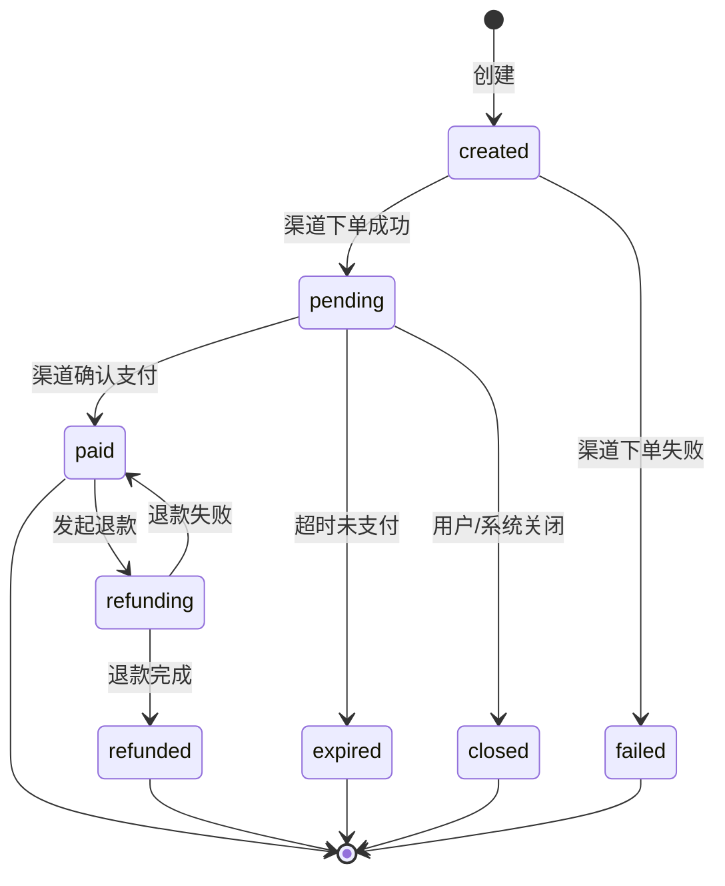
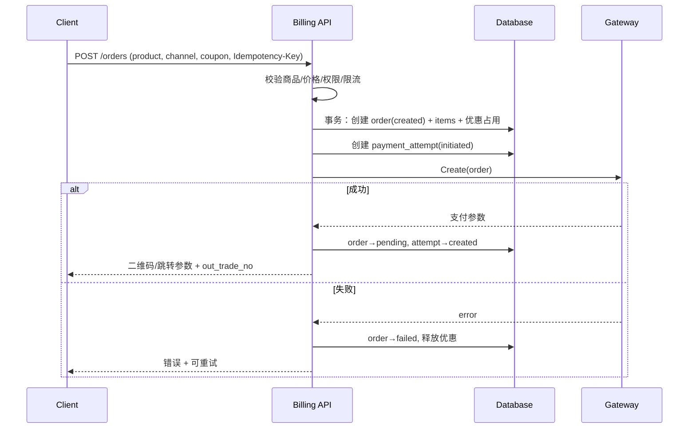
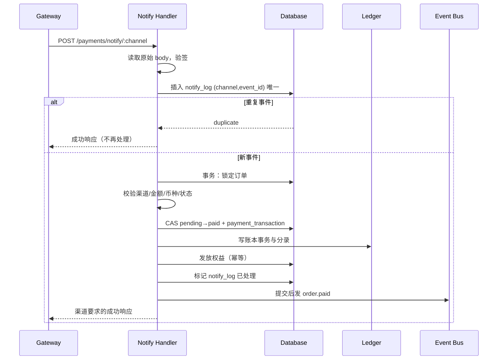

# 12 支付网关与虚拟经济设计

> 目标：**新增支付渠道不改订单、账本、权益与后台核心**。支付是资金相关代码，正确性优先于灵活性。

## 1. 范围

**包含**：商品与定价、订单、支付渠道、支付回调、退款、订阅、权益、余额与积分账本、优惠券、悬赏托管、对账、报表、发票（可选）。
**不包含**：自动续费扣款、多币种汇率换算、提现、分账、跨境合规代办。

## 2. 领域概念

| 概念 | 说明 |
|---|---|
| 商品 Product | 可售卖项：积分包、VIP、邀请码包、付费内容、徽章、自定义 |
| 订单 Order | 一次购买意图，含金额、币种、商品快照、渠道、状态 |
| 支付尝试 Payment Attempt | 一次向渠道发起支付的记录（同一订单可多次尝试） |
| 支付流水 Payment Transaction | 渠道确认的成功/失败交易，含渠道单号 |
| 回调日志 Notify Log | 渠道异步通知的原文、验签与处理结果，用于重放与排查 |
| 退款 Refund | 针对已支付订单的部分/全额退款 |
| 账本 Ledger | 复式记账的余额与积分变动，唯一资金事实来源 |
| 权益 Entitlement | 用户对资源/功能的授权（内容、附件、用户组、有效期） |
| 订阅 Subscription | 周期性权益（VIP），一期手动续费 |
| 余额 Balance | 真实货币充值的站内货币，只能消费，不可提现 |
| 积分 Points | 行为激励积分，可赚取/消费，不可提现、不可转让（默认） |
| 托管 Escrow | 悬赏/担保预冻结，结算或退款 |
| 渠道 Channel | 一个支付实现：余额、人工、支付宝、微信、Stripe、PayPal |

## 3. 分层与包结构

```
internal/modules/billing/
├── module.go            # manifest：路由、权限、设置、后台、事件
├── contracts.go         # OrderService / EntitlementChecker
├── gateway.go           # Gateway 接口、Capabilities、金额类型
├── registry.go          # 渠道注册表
├── service_order.go     # 下单、查询、关闭
├── service_payment.go   # 支付尝试、回调处理
├── service_refund.go    # 退款
├── service_ledger.go    # 复式记账
├── service_entitlement.go
├── service_subscription.go
├── reconcile.go         # 对账与补偿
├── state.go             # 订单/退款状态机与 CAS
├── channels/
│   ├── balance/         # 站内余额（内部渠道）
│   ├── manual/          # 人工转账/对公汇款
│   ├── alipay/
│   ├── wechat/
│   ├── stripe/          # 二期
│   └── paypal/          # 二期
├── handler_web.go
├── handler_api.go
├── handler_admin.go
└── migrations/
```

## 4. 渠道抽象

### 4.1 Gateway 接口

```go
type Gateway interface {
    Name() string
    Capabilities() Capabilities

    Create(ctx context.Context, req CreateRequest) (*CreateResult, error)
    Query(ctx context.Context, req QueryRequest) (*QueryResult, error)
    Refund(ctx context.Context, req RefundRequest) (*RefundResult, error)

    VerifyNotify(ctx context.Context, r *http.Request) (*NotifyEvent, error)
    Ack(ev *NotifyEvent) (status int, body []byte)
}

type Capabilities struct {
    Methods        []Method   // qr / redirect / jsapi / h5 / app
    Currencies     []string
    Refund         bool
    PartialRefund  bool
    Recurring      bool
    Sandbox        bool
    NotifyStyle    string     // html_success / json
}

type CreateRequest struct {
    OutTradeNo  string
    AmountMinor int64
    Currency    string
    Subject     string
    Description string
    ClientIP    string
    ReturnURL   string
    NotifyURL   string
    ExpiresAt   time.Time
    Extra       map[string]string
}

type CreateResult struct {
    Type        string            // qr / redirect / jsapi / app
    QRURL       string
    RedirectURL string
    Params      map[string]string // JSAPI/App 所需参数
    ExpiresAt   time.Time
}

type NotifyEvent struct {
    EventID        string
    OutTradeNo     string
    ChannelTradeNo string
    AmountMinor    int64
    Currency       string
    Status         string    // success / failed / refunded
    PaidAt         time.Time
    Raw            []byte
}
```

约定：

- `VerifyNotify` 必须自行读取并保留**原始请求体**，先验签再解析。
- `Ack` 返回渠道要求的响应格式，不得由 Handler 猜测。
- 渠道实现不得直接写订单表；只返回结果，由 Service 落库。

### 4.2 注册表

```go
type Factory func(cfg ChannelConfig) (Gateway, error)

var registry = map[string]Factory{}

func Register(name string, f Factory) { registry[name] = f }

func Build(ch ChannelConfig) (Gateway, error) {
    f, ok := registry[ch.Driver]
    if !ok {
        return nil, fmt.Errorf("unknown payment driver: %s", ch.Driver)
    }
    return f(ch)
}
```

- 渠道实例来自 `payment_channels` 表，支持同一驱动多实例（如两个支付宝账号）。
- 启动时校验所有启用渠道可构建，失败则禁用该渠道并告警，不影响站点启动。
- 回调路由按渠道实例注册：`/api/v1/payments/notify/:channel`（`:channel` 为渠道实例 ID 或唯一 code）。

### 4.3 渠道能力矩阵

| 渠道 | 方式 | 退款 | 部分退款 | 币种 | 沙箱 | 一期 |
|---|---|---|---|---|---|---|
| balance | 站内即时 | ✅ | ✅ | CNY/积分 | — | ✅ |
| manual | 线下转账，管理员确认 | ✅ | ✅ | 任意 | — | ✅ |
| alipay | 扫码/跳转/H5 | ✅ | ✅ | CNY | ✅ | ✅ |
| wechat | Native/H5/JSAPI | ✅ | ✅ | CNY | ✅ | ✅ |
| stripe | Hosted/跳转 | ✅ | ✅ | 多币种 | ✅ | 二期 |
| paypal | 跳转 | ✅ | ✅ | 多币种 | ✅ | 二期 |

### 4.4 渠道配置 schema

每个渠道声明配置字段，后台动态渲染表单：

```go
type Field struct {
    Key         string
    Label       string
    Type        FieldType // string/secret/bool/int/enum/url
    Required    bool
    Secret      bool
    Placeholder string
    Help        string
    Options     []Option
    Validate    []Rule
}

type Schema struct {
    Driver string
    Fields []Field
}
```

| 渠道 | 典型字段 |
|---|---|
| alipay | app_id、private_key（密钥）、public_key、gateway_url、notify_url、sandbox |
| wechat | mch_id、app_id、api_v3_key、serial_no、private_key、notify_url、sandbox |
| stripe | publishable_key、secret_key、webhook_secret、currency |
| manual | 收款说明、银行信息、二维码图、确认人权限 |
| balance | 无（使用站点币种） |

- 密钥字段 `Secret=true`：AES-GCM 加密存储、界面掩码、审计只记“已更新”。
- 保存前校验必填与格式；“测试连接/沙箱下单”调用渠道自检接口。
- 启停、排序、限额（单笔最小/最大、每日上限）在此配置。

## 5. 订单模型

### 5.1 字段要点

见 [04-数据库设计](./04-数据库设计.md) 的 `orders`。关键约束：

- `out_trade_no` 全局唯一；格式 `GF{YYYYMMDD}{序列}`，不可猜测业务量。
- 保存 `product_snapshot_json`（名称、单价、权益），避免商品改价影响历史订单。
- `amount_minor` 由服务端计算，**绝不接受客户端传入金额**。
- 优惠券、余额抵扣在订单创建时确定并记录明细。

### 5.2 状态机



| 迁移 | 守卫 | 副作用 |
|---|---|---|
| created→pending | 渠道返回支付参数 | 记录支付尝试 |
| created→failed | 渠道报错 | 释放优惠券占用 |
| pending→paid | 回调/查询确认，金额币种一致 | 写流水、入账、发权益、发事件 |
| pending→expired | 超过 `expires_at` | 释放占用、通知 |
| pending→closed | 用户主动/风控 | 调用渠道关单（若支持） |
| paid→refunding | 有退款权限且金额合法 | 冻结可退金额 |
| refunding→refunded | 渠道退款成功 | 冲正账本、回收权益 |
| refunding→paid | 渠道退款失败 | 解冻、记录原因 |

**不变量**：

1. 一个订单最多一次 `paid` 迁移。
2. `sum(refunds.amount) ≤ paid.amount`。
3. 权益按订单只发放一次。
4. 账本借贷平衡；余额 = 分录累计。
5. 已关闭订单若收到渠道支付成功，**不丢单**：置为 paid 并发放权益，同时记异常告警（或按配置自动退款）。

### 5.3 下单流程



要点：

- 外部调用不在数据库事务内，避免长事务与锁等待。
- 同一 `Idempotency-Key` 重复请求返回首次结果（包含支付参数，若未过期）。
- 同一订单重复发起支付：复用未过期 attempt，或关闭旧 attempt 后新建。

## 6. 支付回调

### 6.1 处理流程



### 6.2 校验清单（缺一不可）

1. 签名有效（渠道 SDK/算法）。
2. `event_id` 未处理过（唯一约束，冲突即视为重复）。
3. 订单存在且 `out_trade_no` 匹配。
4. 渠道实例与订单 `channel_id` 一致。
5. 金额与币种与订单完全一致。
6. 订单状态允许迁移（pending/expired/closed 的迟到支付按 5.2 不变量 5 处理）。
7. 渠道交易号未绑定到其他订单。

任一失败：记录 `payment_notify_logs.error`、告警、返回失败（渠道会重试），但**不得**修改订单。

### 6.3 幂等设计

| 层 | 幂等键 | 作用 |
|---|---|---|
| 回调 | `(channel_code, event_id)` 唯一 | 防重放 |
| 订单 | `out_trade_no` 唯一 + CAS | 防重复置 paid |
| 支付流水 | `(channel_code, channel_trade_no, type)` 唯一 | 防重复记账 |
| 账本事务 | `idempotency_key` 唯一，如 `order:{id}:paid` | 防重复入账 |
| 权益 | `(user_id, resource_type, resource_id)` 唯一 | 防重复发放 |
| 通知 | `event_id` 去重 | 防重复提醒 |

## 7. 账本（复式记账）

### 7.1 账户

| 账户 | 类型 | 用途 |
|---|---|---|
| `user:{id}:balance:CNY` | 用户余额 | 充值、消费、退款 |
| `user:{id}:points` | 用户积分 | 行为奖励、消费 |
| `system:gateway_clearing:{currency}` | 系统 | 渠道待清算 |
| `system:revenue` | 系统 | 收入 |
| `system:refund` | 系统 | 退款 |
| `system:points_issuance` | 系统 | 积分发行 |
| `system:escrow:{currency}` | 系统 | 悬赏托管 |

### 7.2 记账规则

每笔业务一个 `ledger_transaction`，至少两条 `ledger_entries`，借贷金额相等：

```
充值 100 元：
  debit  system:gateway_clearing  100
  credit user:alice:balance       100

购买 VIP 30 元（余额）：
  debit  user:alice:balance        30
  credit system:revenue            30

退款 30 元：
  debit  system:refund             30
  credit user:alice:balance        30
```

- `balance_after` 在该账户行上按顺序记录，便于审计。
- 余额更新与分录写入在同一事务；使用行锁或原子更新。
- 余额绝不允许为负（积分消费同理）；不足则拒绝。
- 重算任务：按 `ledger_entries` 汇总每个账户，与缓存余额比对并修复缓存。

### 7.3 与业务表的关系

- `orders.amount_minor` 是应付；`payment_transactions` 是渠道事实；`ledger_*` 是资金事实。
- 三者不一致时：以渠道流水与账本为准，订单状态用于业务展示。
- 禁止直接改余额字段；所有变动必须产生分录。

## 8. 商品与权益

### 8.1 商品类型

| 类型 | 发放 |
|---|---|
| `points_pack` | 积分入账（账本） |
| `vip_plan` | 订阅 + 临时用户组 + 权益 |
| `invite_pack` | 邀请名额增加 |
| `paid_content` | 内容/附件权益 |
| `badge` | 徽章授予 |
| `custom` | 由模块订阅 `order.paid` 自行处理 |

### 8.2 权益发放

```go
func (s *Service) grant(ctx context.Context, tx *gorm.DB, o *Order) error {
    switch o.ProductType {
    case "points_pack":
        return s.ledger.CreditPoints(tx, o.UserID, o.PointsAmount, "order:"+o.ID+":points")
    case "vip_plan":
        sub := s.subscription.Activate(tx, o)
        return s.entitlement.GrantGroup(tx, o.UserID, sub.GroupID, sub.EndsAt, o)
    case "paid_content":
        return s.entitlement.GrantResource(tx, o.UserID, o.ResourceType, o.ResourceID, o)
    }
    return nil
}
```

- 发放必须幂等（唯一键 + 先查后写 + 冲突视为已发放）。
- 发放失败则整个回调事务回滚，渠道会重试；不得出现“钱到账但权益未发”。
- 发放成功后发 `order.paid`，由其它模块追加副作用（通知、积分奖励等）。

### 8.3 订阅

- 状态：`pending → active → expired`，可 `canceled`（到期生效）。
- 开通：写 `subscriptions` 与带过期时间的用户组；到期任务回收用户组与权益。
- 续费：新订单延长 `ends_at`；一期不自动扣款。
- 到期提醒：提前 7 天与 1 天通知。

## 9. 退款

### 9.1 规则

- 可退金额 = `paid - sum(refunded)`；部分退款可多次。
- 退款窗口（默认 7 天）与商品类型可配置；虚拟积分包若已消费，按策略：
  - 默认：仅当积分余额 ≥ 本次退款对应积分时允许，扣回积分后退款；
  - 否则拒绝或转人工。
- 退款需权限 `admin.billing.refund` + 原因 + 二次确认（输入金额）。
- 全额退款后回收权益；部分退款按比例或策略处理（配置）。

### 9.2 流程

```
校验权限/窗口/可退金额
 → 创建 refund(pending)
 → 调用渠道退款
 → 成功：refund→succeeded，order→refunded/paid(部分)，账本冲正，回收权益
 → 失败：refund→failed，解冻，记录原因
 → 异步渠道：refund→processing，轮询/回调后收敛
```

- 退款流水写 `payment_transactions(type=refund)`，渠道退款单号唯一。
- 账本冲正不删除原分录，新增反向分录。
- 退款完成后通知用户，写审计。

## 10. 对账与补偿

### 10.1 定时任务

| 任务 | 频率 | 作用 |
|---|---|---|
| 关闭超时订单 | 每分钟 | pending 超过 `expires_at` → expired，释放占用 |
| 查询未决支付 | 每 5 分钟 | 向渠道查询 pending 订单，补偿丢失回调 |
| 退款重试 | 每 10 分钟 | 处理 failed/processing 退款 |
| 订阅到期 | 每小时 | 回收用户组与权益，发送提醒 |
| 每日对账 | 每日 02:00 | 渠道账单 vs 本地订单/流水 |
| 账本重算 | 每日 03:00 | 分录汇总 vs 缓存余额 |
| 通知日志清理 | 每日 | 保留 180 天 |

### 10.2 对账

- 按渠道、日期拉取账单，匹配 `out_trade_no` 与金额。
- 差异分类：本地有渠道无、渠道有本地无、金额不一致、状态不一致。
- 写入 `reconciliation_runs` / `reconciliation_diffs`，后台展示与导出；差异未解释前告警。
- 自动修复仅限安全场景（如补记回调）；金额差异必须人工处理。

## 11. 优惠券

- 类型：固定金额、百分比（可设上限）。
- 约束：有效期、最低消费、总量、每人限用、适用商品/渠道。
- 下单时校验并锁定库存（原子扣减）；订单失败/过期释放。
- 核销记录 `coupon_redemptions`，退款时按策略返还（默认不返还）。
- 防刷：同用户/同 IP/同设备频率限制；异常领取告警。

## 12. 悬赏托管

- 发布悬赏：校验积分余额 → 冻结（账本：用户积分 → 托管账户）→ 写 `bounties(funded)`。
- 采纳：托管 → 获奖者积分；平台抽成（可配置）→ 系统收入。
- 到期未采纳：托管 → 原用户；可配置自动延期。
- 争议：管理员裁决，必须写审计与原因。
- 不变量：冻结金额不可被重复消费；结算与退款金额守恒。

## 13. 虚拟货币边界

| 项 | 积分 | 余额 |
|---|---|---|
| 获取 | 行为奖励、充值兑换 | 真实支付 |
| 消费 | 邀请、附件、付费内容、抽奖、悬赏 | 商品、订阅、付费内容 |
| 提现 | ❌ | ❌ |
| 转让 | ❌（默认） | ❌ |
| 退款 | 按策略扣回 | 原路退回或退余额 |
| 账本 | points 账户 | balance 账户 |

- 积分与余额分账，禁止直接互换；兑换需显式商品/规则并写账本。
- 所有“送积分/送余额”操作必须可追溯来源与操作人。

## 14. 安全与合规

- 不存储卡号、CVV；仅使用跳转/二维码/Hosted 页面，保持最小 PCI 范围。
- 验签使用渠道官方算法；密钥加密存储、掩码、轮换。
- 金额、币种、渠道、订单归属全部服务端校验。
- 回调独立限流；异常验签失败告警。
- 退款权限分离；大额退款可配置双人复核。
- 风控：下单频率、金额异常、同 IP 多账号、优惠券滥用、退款率异常。
- 合规：真实收款需商户资质；提供用户协议、退款政策、发票能力；不提供规避监管方案。

## 15. 后台与页面

| 页面 | 内容 |
|---|---|
| 商品 | 类型、价格、权益、库存、上下架 |
| 订单 | 筛选、详情（快照/流水/回调/账本）、关闭、补单 |
| 退款 | 发起、审批、状态、重试 |
| 渠道 | schema 表单、沙箱、启停、排序、限额、测试 |
| 对账 | 日期/渠道、差异列表、标记处理、导出 |
| 报表 | 收入、退款、客单价、转化、渠道占比 |

前台：定价页、收银台、订单/账单、订阅、付费内容解锁（见 07 文档）。

## 16. 新增渠道清单

- [ ] 实现 `Gateway` 六个方法
- [ ] 声明 `Capabilities`（方式、币种、退款、部分退款、沙箱）
- [ ] 提供配置 `Schema`（含密文字段）
- [ ] `Register(driver, factory)` 并处理回调路由
- [ ] 实现验签与渠道要求的 `Ack` 响应
- [ ] 实现查询与退款（含异步状态）
- [ ] 实现对账适配（拉取账单或 API）
- [ ] 沙箱集成测试：下单、支付、回调、重复回调、退款、部分退款
- [ ] 后台表单自动出现（无需改 admin 代码）
- [ ] 更新本文档能力矩阵与配置字段

## 17. 监控与告警

| 指标 | 告警 |
|---|---|
| 下单成功率 | < 90% 持续 10 分钟 |
| 支付成功率 | < 95% 持续 15 分钟 |
| 回调验签失败 | 连续 5 次 |
| 回调处理失败 | 单渠道 5 分钟内 > 10 次 |
| 待支付订单积压 | 超过阈值 |
| 退款失败 | 任意失败进入重试队列并告警 |
| 对账差异 | 日终存在未解释差异 |
| 账本不平衡 | 任意一次重算不一致（P0） |
| 权益发放失败 | 任意失败（P0） |

## 18. 测试策略

- 单元：状态机全迁移、金额计算、优惠券、退款规则。
- 并发：同一订单并发回调、并发退款、余额并发扣减，断言只成功一次。
- 幂等：重复回调、重复下单、重复发放权益。
- 异常：金额篡改、币种不符、渠道不符、迟到支付、渠道超时。
- 账本：每笔事务借贷相等；余额 = 分录累计；随机操作后重算一致。
- 沙箱：支付宝/微信沙箱全链路；Stripe/PayPal 测试模式。
- 对账：构造差异数据，断言分类与告警。
- 安全：伪造签名、重放、越权退款。

## 19. 验收标准

1. 新增渠道只需新增实现 + 注册 + schema，订单/账本/后台核心零改动。
2. 回调重放、并发回调不重复发放权益、不重复入账。
3. 金额/币种/渠道任一不符即拒绝并告警，订单不变。
4. 任意时刻 `sum(refunds) ≤ paid`；账本借贷平衡。
5. 余额与积分不可为负；重算结果与缓存一致。
6. 已关闭订单的迟到支付不丢单，按策略入账或自动退款。
7. 退款后权益回收与账本冲正可追溯。
8. 对账能发现人为注入的差异并告警。
9. 不存储任何卡号/CVV；密钥不出现在日志与接口。
10. 支付成功率、回调处理、对账任务均有监控与告警。
