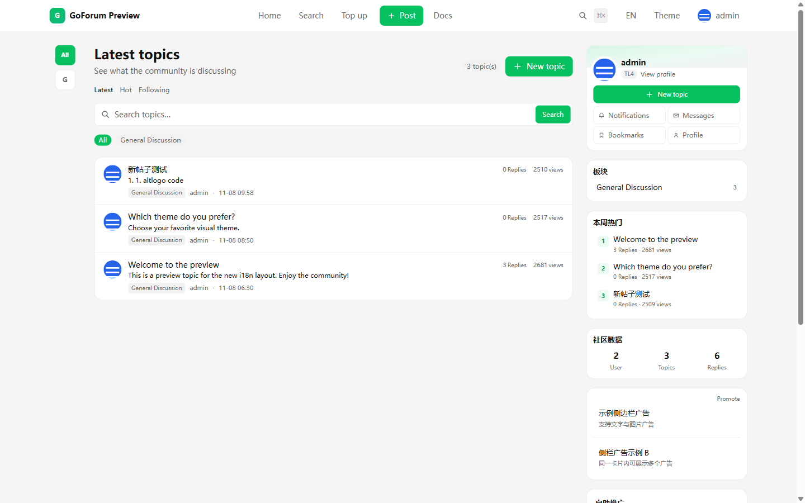
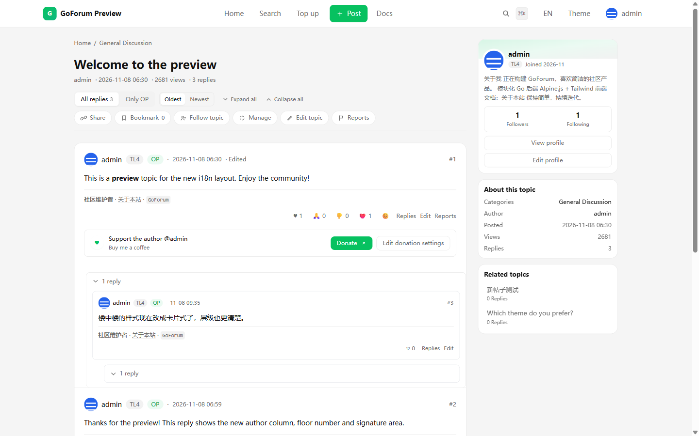
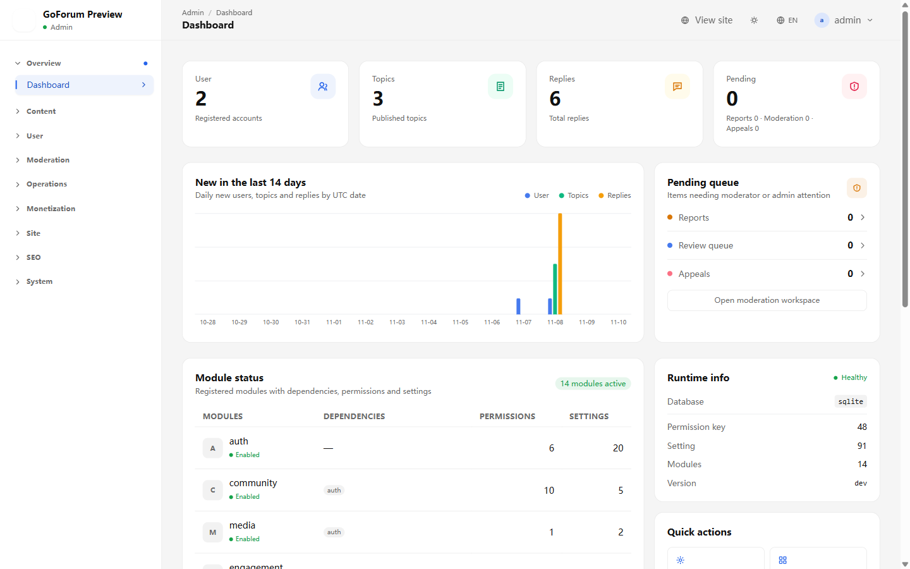
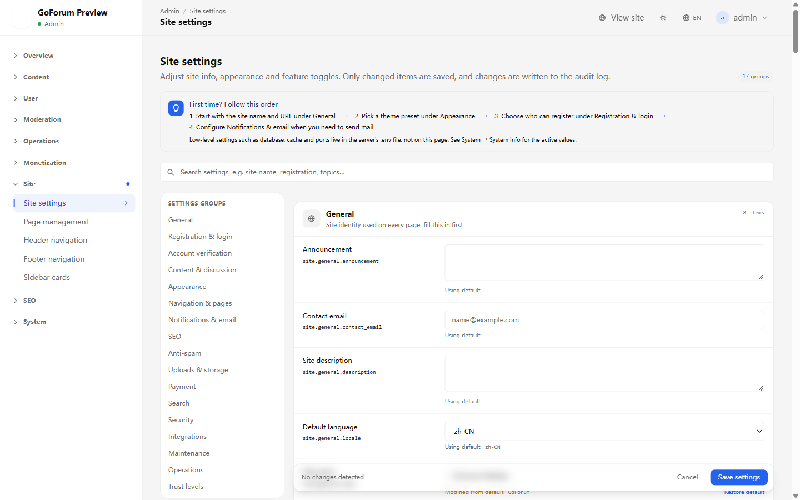
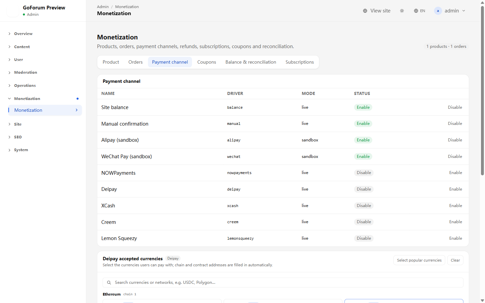
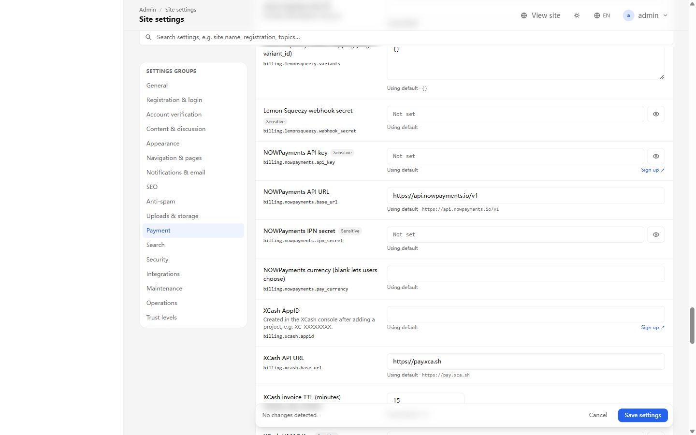

# GoForum Product Documentation

> A self-hosted, modular community forum: a single Go binary, SQLite / MySQL / PostgreSQL, content governance and community operations built in.

## 1. Positioning

GoForum is for communities that want to **own their data and their rules**. It combines Discourse-style content organization and governance with NodeSeek-style points, trust levels, invites and lotteries, plus a complete admin area, internationalization, SEO and payment integrations.

**What it is:**

- A single-binary community forum that can run on one machine
- A settings-driven site: registration policy, email, navigation, themes, SEO, ads, payments and verification switches
- A modular monolith: identity, content, notifications, moderation, gamification and billing are separate modules
- An AI-friendly codebase: clear module contracts, complete docs and runnable tests

**What it is not:**

- Not multi-tenant SaaS; one instance serves one site
- Not an out-of-the-box multi-instance cluster; uploads currently use local disk
- Not a production Alipay/WeChat payment implementation; those channels are sandbox-only
- Not a no-code site builder; deep customization still requires Go development

## 2. Who It Is For

| Audience | Scenario |
|---|---|
| Technical / open-source communities | Categories, tags, search, moderation, trust levels and long-lived content |
| Invite-only / resource communities | Invite codes, points, levels, lotteries, bounties and visibility controls |
| Independent operators | Single-machine deployment, data ownership, no platform fees |
| Internal company communities | Account system, permission groups, audit logs and intranet deployment |
| Product / operations teams | Change rules from the admin area instead of shipping code |

## 3. Core Capabilities

### 3.1 Identity and Access

- Registration modes: open / invite-only / admin approval / closed
- Email verification, password recovery, password change, email change
- Optional email code for password changes
- Google / GitHub OAuth login and account linking
- Session management and device sign-out
- Admin TOTP two-factor authentication, superadmin enforced by default, 10 one-time recovery codes
- Group-based RBAC with explicit permissions and multi-group union
- Trust levels TL0–TL3 from activity, TL4 granted manually
- Invite codes, registration review, mute/ban with expiry

### 3.2 Content and Discussion

- Categories, tags, tag synonyms and related topics
- Topics, replies, nested replies, quotes and best answers
- Polls, multiple reactions, bookmarks, follows and subscriptions
- Markdown/rich editor with toolbar, preview, split view and draft autosave
- Image uploads, thumbnails, quotas and lightbox
- Full-text search: SQLite FTS / MySQL FULLTEXT / PostgreSQL tsvector, with LIKE fallback
- Edit windows, slow mode and auto-close
- RSS, sitemap, structured data, canonical URLs, OG/Twitter cards

### 3.3 Community Governance

- Reports, review queue, actions and reasons
- New-user content review and banned-word filtering
- Mute, ban, reject and pending-review states
- Appeals and appeal review
- Audit log with actor, IP, request ID, target and before/after values
- Ad slots and ad review (admin-only HTML/JS isolated in an iframe)

### 3.4 Growth and Operations

- Points account, ledger, check-in and levels
- Badges, invites, lotteries and escrowed bounties
- Topic tipping and donation entries
- User profiles: bio card, signature, follows/followers, badges, 12-week activity heatmap
- Notification preferences, SSE real-time notifications and direct messages

### 3.5 Monetization

- Products, orders, coupons, subscriptions and entitlements
- Double-entry ledger, reconciliation and refunds (to site balance)
- Payment channels: NOWPayments, XCash, Deipay, Creem and Lemon Squeezy
- Alipay/WeChat: sandbox channels only; production requires your own signing/certificates
- Ad slots and ad campaigns

### 3.6 Admin Console

- Dashboard: users, topics, replies, pending reports/reviews/appeals
- Users and groups: status, trust level, permission groups
- Content: topics, replies, categories and tags
- Site settings: general, registration, account verification, content, appearance, navigation, notifications/email, SEO, anti-spam, uploads, payments, search, security, maintenance
- Login methods: OAuth and password-form switches
- Site pages, navigation, sidebar and ads
- Billing, orders, products and subscriptions
- Points, levels, badges, invites, lotteries and bounties
- Module list, system info and audit logs
- SEO diagnostics, robots.txt editor and sitemap

### 3.7 Platform

- Chinese / English localization with per-feature catalogs
- Databases: SQLite / MySQL / PostgreSQL
- Cache: memory / Redis
- Email: log / SMTP / Resend
- Versioned migrations and startup schema validation
- AES-256-GCM encryption for secret settings
- AES-256-GCM encrypted backups and a restore command
- Health checks `/healthz`, `/readyz` and Prometheus `/metrics`
- Rate limits, body limits, CSRF, CSP, HSTS and security headers

## Screenshots

### Frontend

<p align="center">
  
</p>
<p align="center"><em>Home: topic list, category filter, weekly hot topics, community stats and sidebar cards.</em></p>

<p align="center">
  
</p>
<p align="center"><em>Topic page: body, replies, actions and the right-hand information rail.</em></p>

### Admin

<p align="center">
  
</p>
<p align="center"><em>Dashboard: users, topics, replies, pending work, module status and runtime info.</em></p>

<p align="center">
  
</p>
<p align="center"><em>Site settings: general, registration, verification, email, payment, security and more.</em></p>

<p align="center">
  
</p>
<p align="center"><em>Monetization: payment channels, orders and reconciliation; XCash / NOWPayments sign-up links live next to the API fields under Site settings → Payment.</em></p>

<p align="center">
  
</p>
<p align="center"><em>Payment settings: Sign up links next to the XCash / NOWPayments API keys, plus the XCash AppID, API URL and invoice TTL.</em></p>

## 4. Roles and Permissions

| Role | Description |
|---|---|
| Guest | Browse public content, register, sign in, submit appeals |
| Registered user | Post, reply, interact, DM, report, bookmark, invite |
| TL0–TL4 | Activity-based content trust; TL4 is granted manually |
| Moderator | Review queue, reports, pin/feature/lock, banned words |
| Admin | Admin console, users, content, settings and operations |
| Superadmin | All permissions; TOTP 2FA enforced by default |

Permissions come from groups; multiple groups are unioned. Superadmins bypass checks. Hiding UI is not a security boundary: sensitive actions are re-checked in the service layer.

## 5. Key Journeys

### 5.1 Registration and Sign-in

1. Choose open / invite / approval registration.
2. If email verification is enabled, the user clicks the email link.
3. Sign-in checks the password; admins with TOTP then enter a 6-digit code or recovery code.
4. A session is created and the device/IP is recorded.

### 5.2 Posting and Interaction

1. Pick a category, enter a title and body, optionally add tags and a poll.
2. Publishing adds the topic to lists and the search index.
3. Others reply, quote, react, bookmark and follow.
4. Authors edit, mark a best answer or close; moderators pin/feature/lock.

### 5.3 Reports and Moderation

1. A user reports a topic or reply.
2. The item enters the review queue; thresholds can auto-hide content.
3. A moderator approves, hides, deletes, mutes or bans.
4. The action is audited and can notify the author and reporter.

### 5.4 Payments and Subscriptions

1. An admin configures channels and products.
2. A user places an order and pays through a channel.
3. The webhook is idempotent, updates the order and writes the ledger.
4. Expiry, refunds and reconciliation run through background jobs and admin pages.

### 5.5 Going Live

1. Deploy the binary behind an HTTPS reverse proxy.
2. Open `/install`, choose a database and create the superadmin.
3. Configure site name, URL, email and registration policy.
4. Enroll the superadmin in TOTP and save recovery codes.
5. Set the backup key and schedule daily backups.
6. Disable unused payment channels and verify the ones you keep.

### 5.6 Upgrades

```bash
./goforum backup
./goforum migrate
./goforum
```

Production startup verifies the `schema_migrations` ledger; a missing or stale ledger stops startup and asks you to run migrations.

## 6. Deployment Shapes

| Shape | Fit | Notes |
|---|---|---|
| Single binary + SQLite | Personal / small community | Zero external dependencies; single instance only |
| Single binary + MySQL/PostgreSQL | Medium community | Separate app and database |
| Reverse proxy + HTTPS | All public sites | Nginx/Caddy terminates TLS; app binds loopback |
| Multi-instance | Not yet recommended | Uploads are local disk; object storage is not implemented |

**Minimum production requirements:**

- `APP_ENV=production`
- `APP_URL=https://your-domain`
- `APP_KEY` (generated at install; back it up offline)
- SMTP or Resend
- HTTPS reverse proxy
- `GF_BACKUP_KEY` plus scheduled backups
- A single instance

## 7. Security and Compliance

- Passwords hashed with Argon2id
- Session and email tokens stored as hashes only
- CSRF checks, CSP nonce, HSTS, X-Frame-Options and nosniff
- Route-level rate limits on login, registration, password recovery, OAuth, 2FA and email endpoints
- Per-account email quotas (daily + lifetime) to prevent email abuse
- SMTP/payment/OAuth secrets encrypted at rest with AES-256-GCM
- Admin TOTP with replay protection and one-time recovery codes
- Audit logs for sensitive actions
- Encrypted backups; restore requires a separate backup key
- Uploads restricted to image types with MIME and size checks
- Restrict access to the database, backups and `APP_KEY`, and rehearse restores

Compliance note: privacy policy, terms of service, moderation rules and data-retention policies are the operator's responsibility. GoForum provides static pages and announcements, but not legal text.

## 8. Known Limits

| Item | Status |
|---|---|
| Object storage / S3 | Not implemented; local disk uploads, multi-instance needs a shared volume |
| Alipay / WeChat | Sandbox channels; production requires your own signing/certificates |
| Attachment types | Images only (JPG/PNG/GIF/WebP) |
| 2FA scope | Admins only; not yet available to regular users |
| Migration lock / checksums | No advisory lock; never edit an applied migration |
| Built-in scheduler | Backups and cleanup need external cron |
| Docker | `Dockerfile`, `docker-compose.yml` and a one-command deploy script are included; multi-instance still needs shared storage |
| `APP_KEY` rotation | Invalidates encrypted settings and TOTP secrets; re-enter them |

## 9. Recommended Infrastructure

These are affiliate links. Buying through them costs you nothing extra and supports ongoing maintenance.

<p>
  <a href="https://cloud.vast.ai/?ref_id=91181" target="_blank" rel="sponsored noopener">
    
  </a>
  <a href="https://my.racknerd.com/aff.php?aff=7572" target="_blank" rel="sponsored noopener">
    
  </a>
</p>

- [Vast.ai](https://cloud.vast.ai/?ref_id=91181): on-demand GPU cloud for AI-assisted development, model experiments and batch jobs.
- [RackNerd](https://my.racknerd.com/aff.php?aff=7572): budget VPS for a single-instance GoForum deployment, reverse proxy or backup node.

## 10. Quick Start

```bash
# Local development
npm install
npm run build
go run ./cmd/goforum
# Open http://127.0.0.1:8080/install

# Production build
make build
# Output: bin/goforum
```

One-command production deployment:

```bash
# Bare metal (systemd)
sudo ./scripts/deploy.sh --url https://forum.example.com

# Docker Compose
./scripts/docker-deploy.sh --url https://forum.example.com
```

Production upgrade:

```bash
./goforum backup
./goforum migrate
./goforum
```

## 11. Documentation Index

| Document | Content |
|---|---|
| [English Product](./README.md) | This document |
| [English AI Development](./AI-DEVELOPMENT.md) | Architecture, conventions and task recipes for AI coding agents |
| [中文产品文档](../zh-CN/README.md) | Chinese product documentation |
| [中文 AI 快速开发](../zh-CN/AI-DEVELOPMENT.md) | Chinese AI development guide |
| [Production P0 fixes](../../31-生产部署P0修复.md) | Install, migrations and startup checks |
| [Account verification switches](../../30-账号验证开关.md) | Registration verification, password recovery, email quotas |
| [Admin TOTP](../../32-管理员TOTP两步验证.md) | 2FA policy, enrollment and recovery codes |
| [Secret encryption and versioned migrations](../../33-密钥加密与版本化迁移.md) | Settings encryption and migration ledger |
| [One-command deployment and Docker](../../34-一键部署脚本与Docker.md) | systemd script, Dockerfile/Compose, upgrades and troubleshooting |

## 12. FAQ

**Q: Can it run multi-instance?**
Not yet recommended. Uploads use local disk and object storage is not implemented; SQLite is also single-instance only.

**Q: Can Alipay/WeChat accept real payments?**
They are sandbox channels. Production requires real signing/certificates. NOWPayments, XCash, Deipay, Creem and Lemon Squeezy are real API integrations.

**Q: Can we go live without email?**
You can disable registration email verification, but password recovery, password-change codes and email changes will not work. Public sites should configure SMTP or Resend.

**Q: What if an admin loses TOTP?**
Use a recovery code first. If all are gone, clear that account's `totp_*` columns and enroll again on the next sign-in.

**Q: Will upgrades lose data?**
Migrations do not delete data automatically. Back up first; `goforum migrate` only applies pending migrations.

**Q: Can the 2FA requirement be turned off?**
Yes. Site settings → Security → Admin two-factor policy supports off, superadmin-only or all admins.
