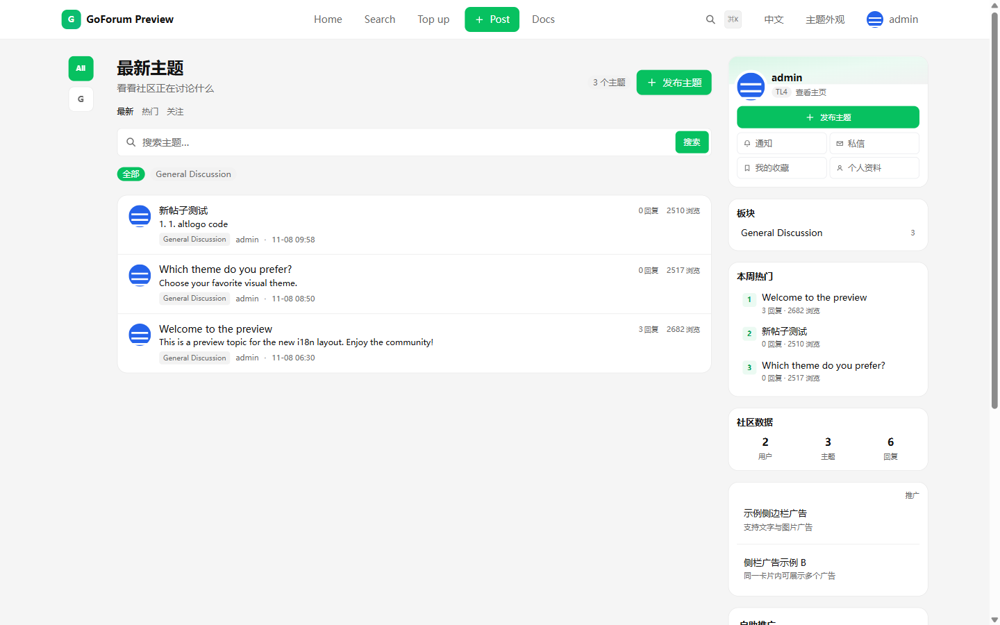
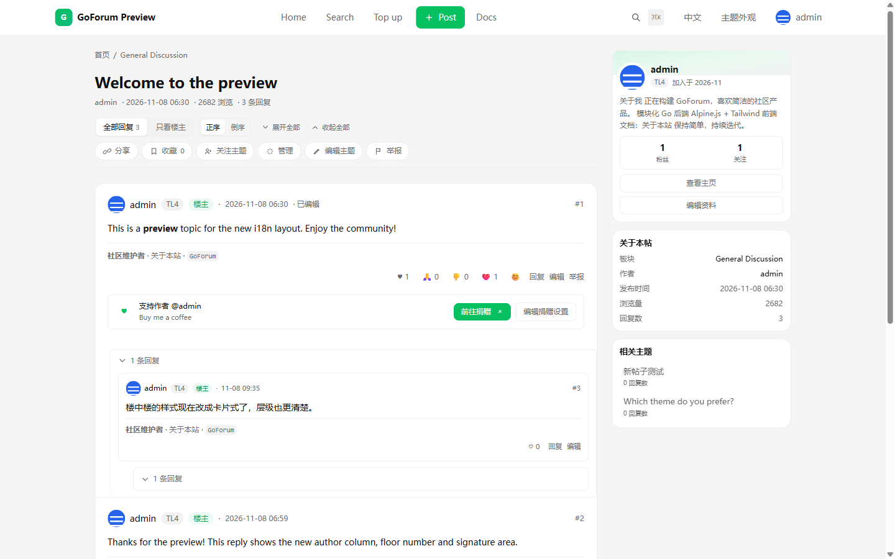
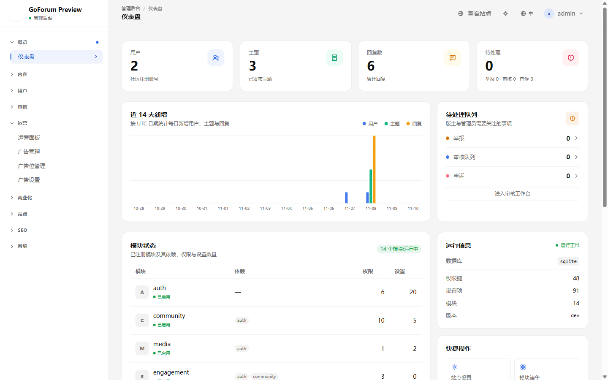
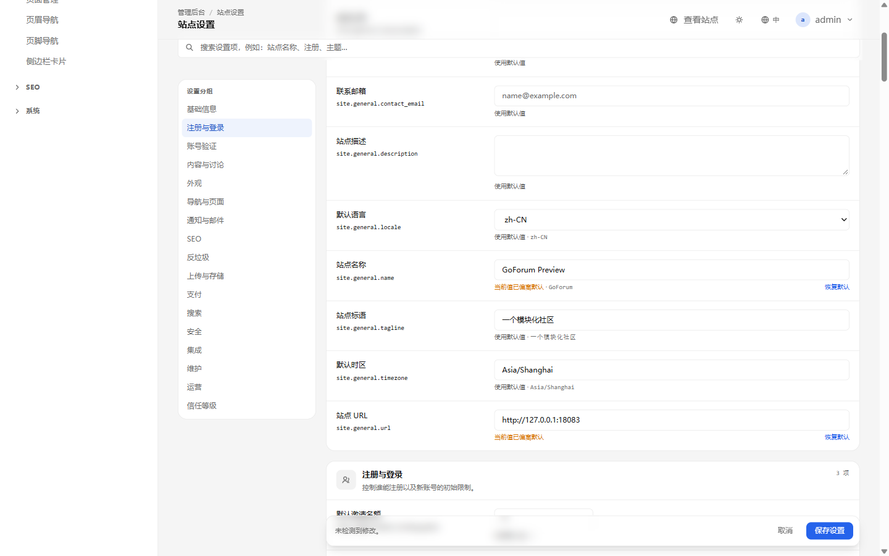
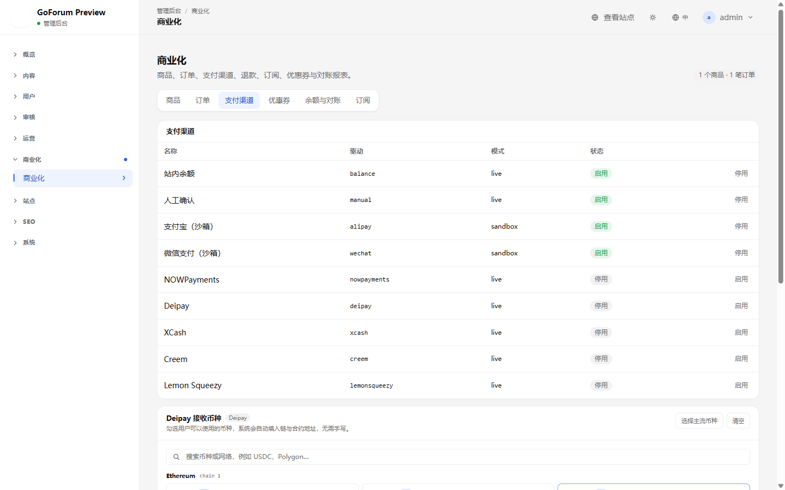
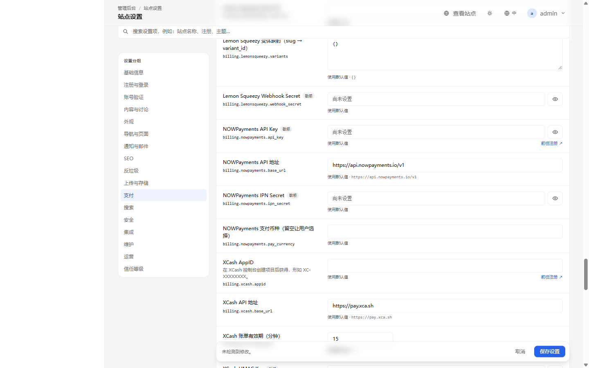

# GoForum 产品文档

> 可自托管的模块化社区论坛：Go 单二进制、SQLite / MySQL / PostgreSQL 自选、内置内容治理与运营玩法。

## 1. 产品定位

GoForum 面向希望**自己掌握数据与规则**的社区团队。它把 Discourse 式的内容组织与治理能力，和 NodeSeek 式的积分、等级、邀请、抽奖等运营能力组合在一起，并提供完整的后台管理、国际化、SEO 与支付接入能力。

**它是什么：**

- 一个可单机部署、单二进制运行的社区论坛
- 一个由后台配置驱动的站点：注册策略、邮件、导航、主题、 SEO、广告、支付、验证开关
- 一个模块化单体：内容、身份、通知、治理、积分、计费各自独立，按需组合
- 一个对 AI 辅助开发友好的代码库：模块契约清晰、文档完整、测试可运行

**它不是什么：**

- 不是多租户 SaaS；一个实例服务一个站点
- 不是开箱即用的多实例集群；当前上传使用本地磁盘
- 不是完整的支付宝/微信生产支付实现；这两个渠道目前是沙箱
- 不是无代码建站工具；深度定制仍需要 Go 开发

## 2. 适合谁

| 用户 | 场景 |
|---|---|
| 技术社区 / 开源社区 | 需要分类、标签、搜索、审核、信任等级与长期内容沉淀 |
| 资源分享 / 邀请制社区 | 需要邀请码、积分、等级、抽奖、悬赏与内容可见性控制 |
| 独立站长 | 希望单机部署、数据自持、无平台抽成 |
| 企业内部社区 | 需要账号体系、权限组、审计与内网部署 |
| 产品/运营团队 | 需要通过后台调整规则，而不是每次改代码 |

## 3. 核心能力

### 3.1 身份与访问

- 注册模式：开放 / 邀请制 / 管理员审核 / 关闭
- 邮箱验证、找回密码、修改密码、修改邮箱
- 修改密码可选邮箱验证码
- Google / GitHub OAuth 登录与账号绑定
- 会话管理与设备下线
- 管理员 TOTP 两步验证，默认超管强制，支持 10 张一次性恢复码
- 用户组 RBAC：权限显式授予，支持多组叠加
- 信任等级 TL0–TL3 按活跃度自动升级，TL4 手动授予
- 邀请码、注册审核、禁言/封禁与到期自动解除

### 3.2 内容与讨论

- 板块、标签、标签同义词、相关主题
- 主题、回复、嵌套回复、引用、最佳答案
- 投票、多表态、收藏、关注、订阅
- 富文本/Markdown 编辑器：工具栏、预览、分屏、草稿自动保存
- 图片上传、缩略图、配额、灯箱
- 全文搜索：SQLite FTS / MySQL FULLTEXT / PostgreSQL tsvector，失败回退 LIKE
- 主题与回复的编辑时限、慢速模式、自动关闭
- RSS、Sitemap、结构化数据、Canonical、OG/Twitter Card

### 3.3 社区治理

- 举报、审核队列、处理动作与理由
- 新用户内容审核、敏感词过滤
- 禁言、封禁、拒绝、待审核状态
- 申诉入口与申诉审核
- 审计日志：操作者、IP、请求 ID、目标与前后值
- 广告位与广告内容审核（管理员可创建 HTML/JS，iframe 隔离）

### 3.4 运营与增长

- 积分账户、流水、签到、等级
- 徽章、邀请、抽奖、悬赏托管
- 主题打赏与捐赠入口
- 用户主页：简介卡片、签名、关注/粉丝、徽章、12 周活跃热力图
- 通知偏好、SSE 实时通知、私信

### 3.5 商业化

- 商品、订单、优惠券、订阅、权益
- 双分录账本、对账、退款（退至站点余额）
- 支付渠道：NOWPayments、XCash、Deipay、Creem、Lemon Squeezy
- 支付宝/微信：当前为沙箱渠道，生产使用需自行接正式签名/证书
- 广告位与广告投放

### 3.6 后台管理

- 仪表盘：用户、主题、回复、待处理举报/审核/申诉
- 用户与用户组：状态、信任等级、权限组
- 内容管理：主题、回复、板块、标签
- 站点设置：基础信息、注册与登录、账号验证、内容、外观、导航、通知与邮件、SEO、反垃圾、上传、支付、搜索、安全、维护
- 登录方式：OAuth 与密码表单开关
- 站点页面、导航、侧边栏、广告
- 计费、订单、商品、订阅
- 积分、等级、徽章、邀请、抽奖、悬赏
- 模块清单、系统信息、审计日志
- SEO 诊断、robots.txt 编辑、sitemap

### 3.7 平台能力

- 中文 / 英文双语，按功能拆分翻译文件
- 数据库：SQLite / MySQL / PostgreSQL
- 缓存：内存 / Redis
- 邮件：日志 / SMTP / Resend
- 版本化迁移与启动 schema 校验
- 设置密钥 AES-256-GCM 加密存储
- 备份 AES-256-GCM 加密、恢复命令
- 健康检查 `/healthz`、`/readyz`，Prometheus `/metrics`
- 限流、请求体上限、CSRF、CSP、HSTS、安全响应头

## 界面预览

### 前台

<p align="center">
  
</p>
<p align="center"><em>首页：主题列表、板块筛选、本周热门、社区数据与侧边栏卡片。</em></p>

<p align="center">
  
</p>
<p align="center"><em>主题页：正文、回复、操作区与右侧信息栏。</em></p>

### 后台

<p align="center">
  
</p>
<p align="center"><em>仪表盘：用户、主题、回复、待处理事项、模块状态与运行信息。</em></p>

<p align="center">
  
</p>
<p align="center"><em>站点设置：基础信息、注册与登录、账号验证、邮件、支付、安全等分组。</em></p>

<p align="center">
  
</p>
<p align="center"><em>商业化：支付渠道、订单与对账；XCash / NOWPayments 的注册入口在「站点设置 → 支付」的 API 表单旁。</em></p>

<p align="center">
  
</p>
<p align="center"><em>支付设置：XCash / NOWPayments API Key 字段旁的「前往注册」按钮，以及 XCash AppID、API 地址与账单有效期。</em></p>

## 4. 角色与权限

| 角色 | 说明 |
|---|---|
| 游客 | 浏览公开内容、注册、登录、申诉 |
| 注册用户 | 发帖、回复、互动、私信、举报、收藏、邀请 |
| TL0–TL4 | 按活跃度提升内容权限与信任度；TL4 手动授予 |
| 版主 | 审核队列、举报处理、置顶/精华/锁定、敏感词 |
| 管理员 | 进入后台，管理用户、内容、设置与运营 |
| 超管 | 全部权限；默认强制启用 TOTP 2FA |

权限由用户组显式授予，多个用户组取并集；超管绕过权限检查。前端隐藏不作为安全边界，所有敏感操作在服务层再次校验。

## 5. 关键流程

### 5.1 注册与登录

1. 选择注册方式：开放 / 邀请 / 审核。
2. 如开启邮箱验证，用户收到验证邮件并点击链接。
3. 登录时校验密码；管理员如启用 TOTP，则进入 6 位验证码或恢复码页面。
4. 登录成功后创建会话，记录 IP 与设备。

### 5.2 发帖与互动

1. 选择板块、填写标题与正文，可加标签、投票。
2. 发布后进入列表与搜索索引。
3. 其他用户回复、引用、表态、收藏、关注。
4. 作者可编辑、设为最佳答案、关闭主题；版主可置顶/精华/锁定。

### 5.3 举报与审核

1. 用户举报主题或回复。
2. 内容进入审核队列；达到阈值可自动隐藏。
3. 版主处理：通过、隐藏、删除、禁言、封禁。
4. 处理结果写入审计日志，可通知作者与举报人。

### 5.4 支付与订阅

1. 管理员配置支付渠道与商品。
2. 用户下单，选择渠道，完成支付。
3. 回调幂等入账，写账本与订单状态。
4. 订阅到期、退款、对账由后台任务与后台页面处理。

### 5.5 管理员上线

1. 部署二进制与 HTTPS 反代。
2. 访问 `/install`，选择数据库并创建超管。
3. 配置站点名称、URL、邮件、注册策略。
4. 超管绑定 TOTP 并保存恢复码。
5. 配置备份密钥与每日备份任务。
6. 关闭不需要的支付渠道，验证保留渠道回调。

### 5.6 升级

```bash
./goforum backup
./goforum migrate
./goforum
```

生产启动会校验 `schema_migrations` 台账；缺失或落后时拒绝启动并提示执行迁移。

## 6. 部署形态

| 形态 | 适用 | 说明 |
|---|---|---|
| 单二进制 + SQLite | 个人 / 小社区 | 零外部依赖；只允许单实例 |
| 单二进制 + MySQL/PostgreSQL | 中型社区 | 应用与数据库分离 |
| 反向代理 + HTTPS | 所有公开站 | Nginx/Caddy 终止 TLS，应用监听回环地址 |
| 多实例 | 暂不推荐 | 上传为本地磁盘，对象存储尚未实现 |

**生产最低要求：**

- `APP_ENV=production`
- `APP_URL=https://你的域名`
- `APP_KEY`（安装时生成，离线备份）
- SMTP 或 Resend
- HTTPS 反代
- `GF_BACKUP_KEY` + 定期备份
- 单实例部署

## 7. 安全与合规

- 密码使用 Argon2id 哈希
- 会话令牌与邮箱令牌仅存哈希
- CSRF 校验、CSP nonce、HSTS、X-Frame-Options、nosniff
- 登录、注册、找回密码、OAuth、2FA、邮件接口均有路由级限流
- 账号级邮件次数配额：单日 + 累计，防止刷邮件
- 设置中的 SMTP/支付/OAuth 密钥使用 AES-256-GCM 加密落库
- 管理员 TOTP，防重放，恢复码单次使用
- 审计日志记录敏感操作
- 备份默认加密；恢复需要独立备份密钥
- 上传仅允许图片类型，校验 MIME 与大小
- 数据库、备份、`APP_KEY` 应限制访问并定期演练恢复

合规提示：隐私政策、服务条款、内容审核规则与数据保留策略需要站点运营者根据所在地法规自行准备；产品提供静态页面与公告能力，但不替代法律文本。

## 8. 已知边界

| 项 | 现状 |
|---|---|
| 对象存储 / S3 | 未实现；上传为本地磁盘，多实例需共享目录 |
| 支付宝 / 微信 | 沙箱渠道；生产需自行接正式签名/证书 |
| 附件类型 | 仅图片（JPG/PNG/GIF/WebP） |
| 2FA 范围 | 仅管理员；普通用户暂未开放 |
| 迁移锁 / 校验和 | 未实现 advisory lock；不要修改已发布迁移 |
| 内置调度器 | 备份、清理等需外部 cron |
| Docker | 已提供 `Dockerfile`、`docker-compose.yml` 与一键部署脚本；多实例仍需共享存储 |
| `APP_KEY` 轮换 | 会导致设置密钥与 TOTP 失效，需重新配置 |

## 9. 推荐基础设施

以下为推广链接；通过链接购买不会增加你的费用，并支持本项目持续维护。

<p>
  <a href="https://cloud.vast.ai/?ref_id=91181" target="_blank" rel="sponsored noopener">
    
  </a>
  <a href="https://my.racknerd.com/aff.php?aff=7572" target="_blank" rel="sponsored noopener">
    
  </a>
</p>

- [Vast.ai](https://cloud.vast.ai/?ref_id=91181)：按需 GPU 云，适合 AI 辅助开发、模型实验与批处理任务。
- [RackNerd](https://my.racknerd.com/aff.php?aff=7572)：预算型 VPS，适合部署 GoForum 单实例、反向代理与备份节点。

## 10. 快速开始

```bash
# 本地开发
npm install
npm run build
go run ./cmd/goforum
# 打开 http://127.0.0.1:8080/install

# 生产构建
make build
# 产物：bin/goforum
```

生产一键部署：

```bash
# 裸机 systemd
sudo ./scripts/deploy.sh --url https://forum.example.com

# Docker Compose
./scripts/docker-deploy.sh --url https://forum.example.com
```

生产升级：

```bash
./goforum backup
./goforum migrate
./goforum
```

## 11. 文档索引

| 文档 | 内容 |
|---|---|
| [中文产品文档](./README.md) | 当前文件 |
| [中文 AI 快速开发](./AI-DEVELOPMENT.md) | 面向 AI 编码代理的架构、约定与任务配方 |
| [English Product](../en-US/README.md) | English product documentation |
| [English AI Development](../en-US/AI-DEVELOPMENT.md) | AI-friendly development guide |
| [生产部署 P0 修复](../../31-生产部署P0修复.md) | 安装、迁移、启动校验 |
| [账号验证开关](../../30-账号验证开关.md) | 注册验证、密码找回、邮件配额 |
| [管理员 TOTP](../../32-管理员TOTP两步验证.md) | 2FA 策略、绑定、恢复码 |
| [密钥加密与版本化迁移](../../33-密钥加密与版本化迁移.md) | 设置加密、迁移台账 |
| [一键部署脚本与 Docker](../../34-一键部署脚本与Docker.md) | systemd 一键脚本、Dockerfile/Compose、升级与排错 |

## 12. 常见问题

**Q：可以多实例部署吗？**
暂不推荐。上传使用本地磁盘，对象存储尚未实现；SQLite 也只能单实例。

**Q：支付宝/微信能直接收款吗？**
当前是沙箱渠道。生产需要接入正式签名/证书；NOWPayments、XCash、Deipay、Creem、Lemon Squeezy 是真实 API 集成。

**Q：不配置邮件能上线吗？**
可以关闭注册邮箱验证，但找回密码、修改密码验证码、换绑邮箱会不可用。公开站应配置 SMTP 或 Resend。

**Q：管理员丢失 TOTP 怎么办？**
优先使用恢复码。恢复码用尽时，需要清空该账号的 `totp_*` 字段，下次登录重新绑定。

**Q：升级会丢数据吗？**
不会自动删除数据。升级前必须备份；`goforum migrate` 只应用未执行的迁移。

**Q：能否关闭 2FA 强制？**
可以，后台「安全 → 管理员两步验证策略」支持关闭或仅超管/所有管理员。
